# Projeto ERP — Petly Club

Projeto Integrador da disciplina **Modelagem de Banco de Dados** (UNICID, 2026/2): do problema real ao banco de dados implementado e consultado.

- **Parte 1 — Primeira entrega (seções 1 a 18):** do problema real ao modelo conceitual de dados, **revisada após a devolutiva do professor** (veja [Revisão após a devolutiva](#revisão-após-a-devolutiva)).
- **Parte 2 — Entrega final (seções 19 a 28):** modelo lógico, normalização, dicionário de dados, SQL, massa de dados, consultas gerenciais e de auditoria e possibilidades de BI e IA. Para executar o banco, veja [Como executar o projeto](#como-executar-o-projeto).

## Sumário

- [Revisão após a devolutiva](#revisão-após-a-devolutiva)
1. [Identificação da equipe](#1-identificação-da-equipe)
2. [Caracterização da empresa](#2-caracterização-da-empresa)
3. [Justificativa da escolha](#3-justificativa-da-escolha)
4. [Problemas identificados](#4-problemas-identificados)
5. [Processos de negócio](#5-processos-de-negócio)
6. [Requisitos funcionais](#6-requisitos-funcionais)
7. [Requisitos não funcionais](#7-requisitos-não-funcionais)
8. [Regras de negócio](#8-regras-de-negócio)
9. [Restrições e políticas organizacionais](#9-restrições-e-políticas-organizacionais)
10. [Fluxogramas](#10-fluxogramas)
11. [Entidades](#11-entidades)
12. [Atributos](#12-atributos)
13. [Relacionamentos](#13-relacionamentos)
14. [Cardinalidades](#14-cardinalidades)
15. [Dicionário de dados conceitual](#15-dicionário-de-dados-conceitual)
16. [DER](#16-der)
17. [Justificativas técnicas](#17-justificativas-técnicas) — inclui [17.1 Cenários de teste](#171-validação-do-modelo-com-cenários-de-teste)
18. [Conclusão da primeira entrega](#18-conclusão-da-primeira-entrega)

**Parte 2 — Entrega final**

19. [Revisão do modelo conceitual na entrega final](#19-revisão-do-modelo-conceitual-na-entrega-final)
20. [Modelo lógico relacional](#20-modelo-lógico-relacional)
21. [Normalização](#21-normalização-1fn-2fn-e-3fn)
22. [Dicionário de dados e implementação SQL](#22-dicionário-de-dados-e-implementação-sql) — inclui [Como executar o projeto](#como-executar-o-projeto)
23. [Massa de dados](#23-massa-de-dados)
24. [Consultas gerenciais](#24-consultas-gerenciais)
25. [Consultas de auditoria](#25-consultas-de-auditoria)
26. [Análise de dados, BI e IA](#26-análise-de-dados-bi-e-ia)
27. [Histórico e evolução do projeto](#27-histórico-e-evolução-do-projeto)
28. [Conclusão](#28-conclusão)

- [Uso de Inteligência Artificial](#uso-de-inteligência-artificial)

## Revisão após a devolutiva

Esta versão corrige os pontos apontados na devolutiva da primeira entrega (nota 7,5). As mudanças de decisão de modelagem estão registradas no formato sugerido pelo manual da entrega final.

| O que foi alterado | Como era | Como ficou | Por que alteramos | Onde está |
|---|---|---|---|---|
| Histórico de estoque (ponto 1) | A quantidade ficava gravada no estoque e era sobrescrita a cada venda ou recebimento; "movimentação de estoque" estava entre os itens que não viraram entidade | Nova entidade MOVIMENTACAO_ESTOQUE registra entradas, reservas, liberações, vendas, devoluções, perdas e ajustes; os saldos do lote são derivados dela, e os registros não podem ser alterados nem excluídos | Sem histórico não era possível explicar diferenças, perdas e devoluções | RN19, RP11, RF33, RF35; seções 5 e 11 a 17; fluxograma 5 |
| Lote de cada venda (ponto 2) | Entidade ESTOQUE com a quantidade por lote, sem ligação com as vendas | ESTOQUE virou LOTE, e cada venda gera uma movimentação por lote utilizado, ligada ao item do pedido | Era preciso saber de qual lote saiu cada unidade, principalmente com validades diferentes | RN20, RF09; cenário 2 |
| Reserva e cancelamento (ponto 3) | A loja virtual dava baixa no pagamento e o cancelamento só "devolvia ao estoque" | A loja virtual reserva no pedido e dá baixa no envio ou na retirada; o cancelamento libera a reserva ou registra devolução ou perda | Produto reservado ainda não saiu do estoque; só o que foi baixado pode ser devolvido | RN21, RN22, RF16, RF20, RF21; fluxogramas 2, 3, 4 e 12; cenários 7 e 8 |
| Pagamento das contas a pagar (ponto 4) | CONTA_PAGAR com um único campo data_pagamento | Nova entidade PAGAMENTO_CONTA (CONTA_PAGAR 1:N PAGAMENTO_CONTA); valor pago derivado; status "paga parcialmente" | Uma parcela pode ser paga em mais de uma vez sem perder o histórico | RN23, RF36; cenário 5 |
| Contas a receber (ponto 5) | PAGAMENTO registrava a venda como paga; contas a receber não eram entidade | PAGAMENTO registra a autorização; nova entidade CONTA_RECEBER (PAGAMENTO 1:N CONTA_RECEBER) com data prevista, data do recebimento e valor líquido; crédito em até 3x | Venda autorizada no cartão não é dinheiro em caixa; o fluxo de caixa precisa separar autorizado, recebido e pendente | RN24, RF25, RF26, RF37; fluxogramas 8 e 9; cenário 6 |
| Compra recebida em partes (parecer) | ITEM_COMPRA só com a quantidade comprada | ITEM_COMPRA com quantidade_comprada e quantidade_recebida (derivada das entradas); compra com status "recebida parcialmente" | O fornecedor pode entregar uma compra em mais de uma vez | RN25, RF34; fluxograma 7; cenário 4 |
| Requisitos não funcionais (ponto 6) | "Tempo adequado", "busca rápida" e "funcionamento contínuo" | Critérios mensuráveis e forma de verificação em todos os RNF; novo RNF10 para vendas simultâneas | Requisito que não pode ser medido não pode ser testado | Seção 7; cenário 1 |
| Documentação (ponto 7) | Uma página por etapa, em arquivos separados | Toda a documentação em um único PDF, na ordem deste README, com os diários em anexo | Pedido da devolutiva | [`docs/Documentacao_Completa_Grupo7.pdf`](docs/Documentacao_Completa_Grupo7.pdf) |
| Diários de bordo (ponto 8) | Versão reescrita para ficar alinhada ao modelo final | Diários preenchidos em sala, digitalizados sem alteração, com um resumo da evolução do projeto e da participação | Os registros precisam mostrar o que foi feito em cada aula | [`diarios-de-bordo/`](diarios-de-bordo/Diarios_de_Bordo_Grupo7.pdf) |
| Validação do modelo (parecer) | Modelo não testado com situações reais | Oito cenários de teste: vendas simultâneas, lotes com validades diferentes, produto vencido, compra recebida em partes, pagamento parcial, crédito em 3x e dois tipos de cancelamento | Recomendação do parecer formativo | Seção 17.1 |

## 1. Identificação da equipe

**Grupo:** 7  
**Empresa:** Petly Club, pet shop fictício de pequeno porte inspirado na Cobasi e no Sam's Club

**Gerente do grupo:** Nicolas Da Silva Santos

| Integrante | RGM |
|---|---|
| Amin Brayan Illanes Callata | 48214051 |
| Carolina Da Silva Burrego | 47793431 |
| Gabriela Colombo Martins Blach | 47132281 |
| João Paulo de Lima Rodrigues | 47850876 |
| Murilo Queiroz Braga | 48091251 |
| Nicolas Da Silva Santos (gerente do grupo) | 47889756 |
| Nicolas Miguel Tavares | 47658037 |
| Ryan Everton Andrade Simões | 47647663 |
| Vinicius Ferreira da Silva | 47432691 |
| Yasmin America Mollinedo Alba | 47071303 |

## 2. Caracterização da empresa

**Nome:** Petly Club

**Segmento:** Pet shop — comércio de produtos para animais de estimação

**Porte:** Pequena empresa, com uma loja física e uma loja virtual

**Inspiração:** Cobasi e Sam's Club

A Petly Club é um pet shop fictício de pequeno porte, com operação simulada para o escopo da disciplina. O modelo de negócio foi inspirado em duas empresas reais: da **Cobasi**, vêm os produtos, a mecânica de compras e a venda de rações e demais itens para animais; do **Sam's Club**, vem o modelo de clube de compras, em que o cliente precisa obrigatoriamente ter cadastro para comprar.

A empresa atua exclusivamente na venda de produtos para animais de estimação, por dois canais: uma loja física, com atendimento presencial e caixa, e uma loja virtual, na qual o cliente realiza o pedido pela internet e escolhe entre receber em casa ou retirar na loja.

### O que a empresa vende

- **Alimentação:** rações secas e úmidas, petiscos e suplementos;
- **Higiene e limpeza:** areia sanitária, tapetes higiênicos e shampoos;
- **Acessórios:** coleiras, guias, camas, comedouros, bebedouros e brinquedos;
- **Produtos para outras espécies:** gaiolas, aquários, filtros e alimentos para aves, peixes e roedores.

A empresa **não** oferece serviços de banho e tosa, atendimento veterinário ou venda de animais. Toda a sua operação gira em torno da comercialização de produtos.

### Principais clientes

Os clientes são tutores de animais de estimação (pessoas físicas). Parte das compras é recorrente, como ração e areia sanitária, e parte é ocasional, como acessórios e brinquedos. Na loja física predominam clientes da região, que buscam compra imediata; na loja virtual, clientes que valorizam a conveniência da entrega, principalmente em compras volumosas e recorrentes.

Inspirada no modelo de clube de compras do Sam's Club, a Petly Club só vende para clientes cadastrados, tanto na loja física quanto na loja virtual. Quem ainda não tem cadastro pode fazê-lo no momento da primeira compra.

### Principais setores

- **Vendas — loja física:** atendimento ao cliente e operação do caixa;
- **Vendas — loja virtual:** recebimento dos pedidos online, separação e expedição;
- **Estoque:** recebimento, conferência e armazenamento das mercadorias, incluindo o acompanhamento da validade dos produtos alimentícios;
- **Compras:** relacionamento com fornecedores e reposição de mercadorias;
- **Financeiro:** contas a pagar e a receber, controle dos pagamentos e fechamento de caixa;
- **Gerência:** definição de preços e promoções e acompanhamento dos resultados.

### Como a empresa funciona atualmente

Os dois canais de venda funcionam de forma separada. A loja física registra suas vendas no sistema do caixa, enquanto a loja virtual utiliza uma plataforma de comércio eletrônico própria. No entanto, as mercadorias ficam em um único estoque, compartilhado pelos dois canais e controlado em planilha atualizada manualmente.

Produtos e clientes são cadastrados separadamente em cada canal. As compras são decididas pela gerência com base na conferência das prateleiras e em listas de fornecedores mantidas em planilha. O financeiro consolida manualmente, ao final do dia, os valores do caixa e das vendas online.

Com isso, a empresa possui as informações de que precisa, mas elas estão espalhadas em sistemas e planilhas que não se comunicam.

### Informações importantes para o negócio

- Clientes e endereços de entrega dos pedidos da loja virtual;
- Produtos, categorias e preços;
- Quantidade disponível em estoque, por lote, e validade dos produtos alimentícios;
- Histórico das movimentações de estoque: entradas, vendas, devoluções, perdas e ajustes;
- Vendas de cada canal e os produtos vendidos em cada uma;
- Formas de pagamento, incluindo cartão de crédito em até 3x sem juros;
- Fornecedores e compras realizadas;
- Contas a pagar e a receber, separando o que já foi pago ou recebido do que ainda está pendente.

## 3. Justificativa da escolha

A Petly Club foi escolhida por reunir, em um negócio de fácil compreensão, as características necessárias para um projeto de modelagem de dados e de ERP.

**Processos que podem ser analisados.** A empresa possui uma cadeia completa de processos comerciais: venda presencial, venda online, entrega ou retirada, reposição de mercadorias, recebimento de fornecedores e controle financeiro. Cada um deles gera informações que precisam ser registradas e consultadas.

**Problemas de organização das informações.** Os dois canais de venda utilizam o mesmo estoque, mas registram suas operações em sistemas separados, e o estoque é controlado manualmente. Esse cenário gera cadastros duplicados, informações desatualizadas e dificuldade de acompanhar os resultados, situação típica que um banco de dados único e bem modelado resolve.

**Necessidade de integração.** Na Petly Club, os setores dependem uns dos outros: uma venda, em qualquer canal, reduz o estoque; a queda do estoque exige uma compra; a compra gera uma conta a pagar; e a venda gera uma conta a receber. Essa dependência evidencia a necessidade de um sistema integrado, e não de controles isolados por setor.

**Aplicação de um ERP, BI e IA.** Com os dados organizados, a empresa poderá responder a perguntas estratégicas, como: quais produtos têm maior giro em cada canal, quando um produto precisa ser reposto e quando um cliente provavelmente voltará a comprar ração. Como boa parte das compras do segmento é recorrente, os dados históricos são especialmente úteis para análises e previsões.

**Cadastro obrigatório dos clientes.** Como toda compra exige o cadastro do cliente, modelo inspirado no Sam's Club, a empresa passa a ter o histórico de compras de todos os seus clientes. Isso permite identificar padrões de recompra e oferecer um atendimento mais personalizado, o que não seria possível se parte das vendas fosse feita sem identificação.

**Delimitação do escopo.** A equipe optou por excluir serviços (banho e tosa e atendimento veterinário) e a venda de animais. Os serviços exigiriam controlar agendamentos, profissionais, animais atendidos e histórico clínico, o que pertence a outro domínio de negócio; a venda de animais envolve exigências sanitárias e legais específicas. Com esse recorte, a equipe pode concentrar a modelagem nos processos de comercialização de produtos e tratá-los com maior profundidade.

## 4. Problemas identificados

| Problema | Consequência | Necessidade |
|---|---|---|
| Produtos e clientes são cadastrados separadamente no sistema da loja física e na plataforma da loja virtual | Gera cadastros duplicados | Cadastro único de clientes e produtos para os dois canais |
| O estoque, que é compartilhado pelos dois canais, é controlado em uma planilha atualizada manualmente | Gera informações desatualizadas e risco de vender produtos sem estoque | Estoque único atualizado automaticamente a cada venda e recebimento |
| A planilha guarda apenas o saldo atual de cada produto, sem registrar as entradas, saídas, perdas, devoluções e ajustes | Não é possível explicar diferenças de estoque, identificar perdas nem saber de qual lote saiu cada venda | Histórico de todas as movimentações de estoque, por lote |
| Pedidos da loja virtual e vendas do caixa disputam o mesmo produto sem nenhuma reserva | Um produto pode ser vendido no caixa enquanto já está prometido a um pedido online | Reserva dos produtos dos pedidos da loja virtual até o envio ou a retirada |
| As vendas da loja física e virtual funcionam de forma separada e não se comunicam com as outras planilhas | Informações necessárias ao negócio ficam espalhadas e isoladas | Registro de todas as vendas em um único sistema, identificando o canal |
| O setor financeiro realiza a consolidação dos valores do caixa e das vendas online de forma manual ao final do dia | Retrabalho diário devido à ausência de um sistema integrado e dependência de controles isolados | Integração entre vendas, pagamentos e contas a pagar, com fechamento de caixa automático |
| O financeiro não diferencia uma venda aprovada no cartão do dinheiro que efetivamente entrou na conta, principalmente no crédito parcelado | O fluxo de caixa fica impreciso e não é possível saber quanto ainda falta receber | Contas a receber com data prevista e data do recebimento efetivo |
| As parcelas devidas aos fornecedores são controladas em planilha, sem registro dos pagamentos feitos | Pagamentos parciais se perdem e o histórico financeiro fica incompleto | Registro de cada pagamento feito em cada parcela |
| As decisões de compras são baseadas na conferência manual das prateleiras e em planilhas de fornecedores | Sem automatização, exigindo controle manual para identificar a necessidade de reposição de mercadorias | Alerta de estoque mínimo e registro das compras por fornecedor |
| A validade dos produtos alimentícios não é controlada de forma sistemática | Risco de manter produtos vencidos disponíveis para venda | Registro de lote e validade na entrada e bloqueio da venda de produtos vencidos |
| Informações espalhadas em sistemas separados e operadas com controles isolados por cada setor | Dificuldade de acompanhar os resultados financeiros e o desempenho das vendas | Relatórios integrados de vendas por produto, categoria e canal |

## 5. Processos de negócio

### 1. Venda na loja física

Cliente → Verificar o cadastro → Escolhe produtos → Atendente registra o pedido → Caixa recebe o pagamento (por Pix, cartão de crédito/débito ou dinheiro) → Baixa no estoque, por lote

- **Quem participa** - Cliente, atendente ou operador de caixa e funcionário do estoque.
- **O que inicia o processo** - O cliente escolhe um ou mais produtos na loja física.
- **O que acontece** - Verifica-se se o cliente possui cadastro; se tiver, segue para a compra, e se não tiver, o cliente é cadastrado na hora (RP02). Os produtos e suas quantidades são registrados no pedido pelo funcionário responsável (RN14), o pagamento é autorizado e, ao concluir a venda, o sistema dá baixa no estoque registrando uma movimentação de venda para cada lote utilizado, começando pelo lote de validade mais próxima (RN20, RN21).
- **Qual informação é gerada** - Cliente, funcionário responsável, pedido, produtos vendidos, quantidades, preços praticados, lotes de onde saíram os produtos, forma de pagamento e canal de venda.
- **Qual é o resultado** - Venda registrada, pagamento autorizado e estoque atualizado com o histórico da saída.

### 2. Venda na loja virtual

Cliente → Cadastra → Acessa a loja virtual → Seleciona produtos → Realiza o pedido → Produtos são reservados → Efetua o pagamento (por Pix ou cartão de crédito/débito) → Pagamento confirmado (pagamento não confirmado libera a reserva e cancela o pedido) → Pedido é separado

- **Quem participa** - Cliente, funcionário responsável pelos pedidos virtuais, estoque e financeiro.
- **O que inicia o processo** - O cliente acessa a loja virtual e seleciona os produtos.
- **O que acontece** - O cliente realiza o pedido, escolhe a forma de recebimento (entrega ou retirada) e informa o endereço quando escolhe entrega. Ao registrar o pedido, o sistema reserva as quantidades em lotes específicos, que deixam de estar disponíveis para outras vendas (RN21). Com o pagamento confirmado, os produtos são separados; se o pagamento não for confirmado, a reserva é liberada e o pedido é cancelado (RN22).
- **Qual informação é gerada** - Dados do cliente, endereço de entrega, pedido, itens, quantidades, preços, lotes reservados, pagamento, status e canal de venda.
- **Qual é o resultado** - Pedido online registrado, pago, com os produtos reservados e preparado para entrega ou retirada.

### 3. Entrega do pedido

Pedido online → Produtos são separados → Pedido é conferido → Pedido é enviado → Baixa no estoque → Entrega é confirmada

- **Quem participa** - Funcionário da loja virtual, funcionário do estoque, responsável pela entrega e cliente.
- **O que inicia o processo** - A confirmação de um pedido online com entrega em domicílio.
- **O que acontece** - Os produtos são separados, conferidos e encaminhados para entrega. No envio, a reserva é convertida em baixa: o sistema registra a movimentação de venda de cada lote reservado (RN21). Quando o cliente recebe, a entrega é confirmada.
- **Qual informação é gerada** - Endereço de entrega, data prevista, data da entrega, movimentações de venda e status do pedido e da entrega.
- **Qual é o resultado** - Produtos entregues ao cliente, estoque baixado e pedido finalizado.

### 4. Retirada do pedido na loja

Pedido online → Produtos são separados → Pedido fica disponível → Cliente vai à loja → Funcionário confere o código do pedido → Funcionário entrega o pedido → Baixa no estoque

- **Quem participa** - Cliente, funcionário da loja virtual, atendente e estoquista.
- **O que inicia o processo** - O cliente escolhe a opção de retirada na loja.
- **O que acontece** - Os produtos são separados e continuam reservados até a retirada. O cliente comparece à loja, o funcionário confere o código do pedido e entrega os produtos; nesse momento, a reserva é convertida em baixa no estoque (RN21).
- **Qual informação é gerada** - Pedido, código do pedido, produtos separados, opção de retirada, movimentações de venda e status do pedido.
- **Qual é o resultado** - Pedido retirado pelo cliente, estoque baixado e processo de venda concluído.

### 5. Controle de estoque

Ocorrência no estoque (entrada, reserva, venda, devolução, perda ou ajuste) → Movimentação é registrada no lote → Saldo do lote é recalculado → Validade dos lotes é acompanhada → Estoque mínimo é verificado

- **Quem participa** - Estoquista, atendente, funcionário da loja virtual e gerência.
- **O que inicia o processo** - Uma venda, um pedido da loja virtual, o recebimento de produtos, um cancelamento, uma perda (produto vencido ou danificado) ou uma conferência do estoque.
- **O que acontece** - Toda alteração de quantidade é registrada como uma movimentação do lote, com tipo, quantidade, data, hora, responsável e motivo (RN19). As movimentações não são apagadas: correções são feitas por novos ajustes. Lotes vencidos são retirados da venda por movimentação de perda (RP09), e perdas e ajustes precisam de autorização da gerência (RP11).
- **Qual informação é gerada** - Lote, tipo de movimentação, quantidade, data e hora, responsável, motivo, saldo físico, quantidade reservada e quantidade disponível.
- **Qual é o resultado** - Estoque atualizado, com o histórico completo de cada lote, e produtos disponíveis para os dois canais de venda.

### 6. Reposição de mercadorias

Estoque atinge o nível mínimo → Gerência identifica a necessidade → Fornecedor é consultado → Compra é realizada → Contas a pagar são geradas → Mercadorias são recebidas

- **Quem participa** - Estoquista, gerência, setor de compras, financeiro e fornecedor.
- **O que inicia o processo** - A quantidade de um produto atinge o estoque mínimo definido pela gerência (RP03).
- **O que acontece** - A necessidade de reposição é verificada, o fornecedor é consultado e uma compra é realizada. O valor da compra gera uma ou mais contas a pagar, podendo ser dividido em parcelas (RN12).
- **Qual informação é gerada** - Produto necessário, quantidade da compra, custo unitário, fornecedor, dados da compra e parcelas a pagar.
- **Qual é o resultado** - Mercadorias solicitadas ao fornecedor para recompor o estoque e contas a pagar registradas.

### 7. Recebimento de mercadorias

Fornecedor entrega mercadorias → Funcionário autorizado recebe → Produtos são conferidos com a compra → Verificar registro do lote e validade → Movimentação de entrada é registrada → Compra recebida por completo? (não: fica recebida parcialmente e aguarda nova entrega)

- **Quem participa** - Fornecedor, funcionário autorizado do estoque e setor de compras.
- **O que inicia o processo** - A chegada das mercadorias entregues pelo fornecedor, em uma ou mais entregas.
- **O que acontece** - Os produtos recebidos são conferidos com a compra e armazenados. Somente funcionários autorizados registram a entrada (RP06). Para produtos com controle de validade, o lote e a data de validade são registrados (RN11). Cada entrega gera movimentações de entrada ligadas ao item da compra; se a quantidade recebida for menor que a comprada, a compra fica como recebida parcialmente até as próximas entregas (RN25).
- **Qual informação é gerada** - Fornecedor, compra, produtos recebidos, quantidade comprada, quantidade recebida, lote, validade e data de entrada.
- **Qual é o resultado** - Mercadorias armazenadas, saldo do estoque atualizado e situação da compra conhecida.

### 8. Pagamento da venda

Pedido registrado → Cliente escolhe a forma de pagamento (por Pix, cartão de crédito em até 3x, débito ou dinheiro) → Pagamento é autorizado → Contas a receber são geradas → Venda é confirmada

- **Quem participa** - Cliente, operador de caixa ou plataforma da loja virtual e financeiro.
- **O que inicia o processo** - A finalização de um pedido na loja física ou virtual.
- **O que acontece** - O cliente escolhe uma ou mais formas de pagamento (RN15) e o pagamento é autorizado. A autorização gera as contas a receber: uma para dinheiro, Pix ou débito, e uma por parcela no crédito parcelado em até 3x (RN24). O valor só é considerado recebido quando entra na conta da empresa. Descontos acima do limite precisam de autorização da gerência (RP05).
- **Qual informação é gerada** - Forma de pagamento, valor autorizado, número de parcelas, desconto, pedido relacionado, status do pagamento e contas a receber com data prevista.
- **Qual é o resultado** - Pagamento autorizado, valores a receber registrados e venda confirmada.

### 9. Controle financeiro

Contas a receber e a pagar são registradas → Recebimentos efetivos são conciliados → Pagamentos aos fornecedores são registrados (inclusive parciais) → Caixa é fechado → Fluxo de caixa é consolidado

- **Quem participa** - Financeiro, operador de caixa e gerência.
- **O que inicia o processo** - Uma venda autorizada, uma compra, o vencimento de uma parcela ou o recebimento de valores da operadora de cartão.
- **O que acontece** - O financeiro confere quais valores autorizados já entraram na conta (recebidos) e quais ainda estão pendentes. Uma parcela devida ao fornecedor pode ser paga em um ou mais pagamentos; ela só fica quitada quando a soma dos pagamentos atinge o seu valor (RN23). O fechamento do caixa considera apenas os valores efetivamente recebidos.
- **Qual informação é gerada** - Contas a receber pendentes e recebidas, contas a pagar com os pagamentos feitos e o saldo devedor, valores do caixa e fluxo de caixa previsto e realizado.
- **Qual é o resultado** - Fechamento do caixa e informações financeiras consolidadas, separando o que foi autorizado, o que foi recebido e o que ainda está pendente.

### 10. Cadastro de produtos

Novo produto → Funcionário cadastra informações → Categoria e preço são definidos → Estoque mínimo e controle de validade são definidos → Produto fica disponível para venda

- **Quem participa** - Funcionário responsável pelo cadastro, estoque e gerência.
- **O que inicia o processo** - A inclusão de um novo produto no catálogo da empresa.
- **O que acontece** - São cadastrados o nome, a descrição, a marca, o código de barras, a categoria, o preço atual, o estoque mínimo e se o produto exige controle de validade. Somente a gerência define e altera preços (RP04).
- **Qual informação é gerada** - Identificador, nome, descrição, marca, código de barras, categoria, preço, estoque mínimo e controle de validade.
- **Qual é o resultado** - Produto cadastrado e disponível para utilização nos pedidos.

### 11. Cadastro de clientes

Cliente realiza uma compra → Dados são informados → Cadastro é realizado → Cliente é vinculado ao pedido

- **Quem participa** - Cliente e funcionário responsável pelo atendimento ou sistema da loja virtual.
- **O que inicia o processo** - Uma compra, já que toda venda exige a identificação do cliente (RP02).
- **O que acontece** - São registrados os dados do cliente. O CPF não pode ser cadastrado mais de uma vez (RN18). O endereço de entrega não faz parte do cadastro: ele é informado em cada pedido da loja virtual com entrega.
- **Qual informação é gerada** - Nome, CPF, telefone e e-mail.
- **Qual é o resultado** - Cliente cadastrado e relacionado ao pedido realizado.

### 12. Cancelamento de pedido

Solicitação de cancelamento → Verificação da regra de cancelamento → Autorização (quando necessária) → Produtos estavam só reservados? (sim: libera a reserva; não: registra devolução ou perda) → Pagamento é estornado → Pedido é cancelado

- **Quem participa** - Cliente, atendente ou operador de caixa, gerência e funcionário da loja virtual.
- **O que inicia o processo** - O pedido do cliente para cancelar uma compra ou a falta de confirmação do pagamento online.
- **O que acontece** - Pedidos da loja virtual só podem ser cancelados antes do envio; cancelamentos na loja física precisam de autorização da gerência (RP07). Se os produtos estavam apenas reservados (pedido da loja virtual ainda não enviado ou retirado), o sistema registra a liberação da reserva. Se já tinham sido baixados (venda concluída na loja física), os produtos voltam ao lote de origem por movimentação de devolução; produtos danificados ou vencidos são registrados como perda (RN22). O pagamento é estornado e as contas a receber ligadas a ele são canceladas.
- **Qual informação é gerada** - Pedido cancelado, funcionário que autorizou, movimentações de liberação, devolução ou perda, status do pedido, do pagamento e das contas a receber.
- **Qual é o resultado** - Pedido cancelado, estoque corrigido com o histórico do cancelamento e valores a receber ajustados.

## 6. Requisitos funcionais

### Cadastros Básicos

- **RF01:** O sistema deverá permitir o cadastro completo de produtos, incluindo nome, descrição, categoria, marca, código de barras, preço de venda e estoque mínimo.
- **RF02:** O sistema deverá ter uma opção para marcar se o produto necessita de acompanhamento de lote e data de validade.
- **RF03:** O sistema deverá cadastrar os clientes, com nome, CPF, telefone e e-mail.
- **RF04:** O sistema deverá manter o registro de fornecedores da loja.
- **RF05:** O sistema deverá cadastrar os funcionários e definir o perfil de acesso de cada um de acordo com o cargo.
- **RF28:** O sistema deverá cadastrar as categorias de produtos.

### Estoque Único, Lotes e Movimentações

- **RF06:** O sistema deverá centralizar a contagem do estoque em um saldo único, atendendo ao mesmo tempo as vendas da loja virtual e da loja física.
- **RF07:** O sistema deverá registrar as compras de reposição feitas aos fornecedores e a entrada das mercadorias recebidas no estoque.
- **RF08:** O sistema deverá gravar a data de validade e o lote de cada produto com controle de validade no momento do recebimento.
- **RF09:** O sistema deverá dar baixa no estoque automaticamente quando a venda da loja física for concluída e quando o pedido da loja virtual for enviado ou retirado, indicando o lote de onde saiu cada unidade.
- **RF10:** O sistema deverá impedir a venda ou a reserva de uma quantidade maior do que a disponível em estoque, considerando o saldo físico menos as quantidades já reservadas.
- **RF11:** O sistema deverá sugerir a saída prioritária dos lotes que estiverem mais próximos de vencer.
- **RF12:** O sistema deverá bloquear a saída e a venda de produtos cuja data de validade já tenha expirado.
- **RF13:** O sistema deverá emitir um alerta quando o saldo em estoque de um produto atingir o estoque mínimo definido para ele.
- **RF33:** O sistema deverá registrar toda movimentação de estoque (entrada, reserva, liberação de reserva, venda, devolução, perda e ajuste) com o lote, a quantidade, a data, a hora, o responsável e o motivo, e permitir consultar o histórico de cada lote.
- **RF34:** O sistema deverá registrar o recebimento parcial de uma compra, mantendo a quantidade comprada e a quantidade já recebida de cada produto.
- **RF35:** O sistema deverá registrar perdas e ajustes de estoque somente com autorização da gerência e com o motivo informado.

### Operação de Vendas no Caixa (PDV)

- **RF14:** O sistema deverá registrar as vendas realizadas no balcão da loja física, vinculando o cliente e o funcionário responsável.
- **RF15:** O sistema deverá aceitar pagamentos em dinheiro, PIX, cartão de débito e cartão de crédito em até 3 parcelas sem juros, e permitir mais de uma forma de pagamento no mesmo pedido.
- **RF16:** O sistema deverá permitir cancelar itens ou vendas no caixa somente quando o gerente autorizar com sua senha, registrando a devolução dos produtos ao lote de origem ou a perda, quando danificados ou vencidos.
- **RF30:** O sistema deverá permitir cadastrar o cliente no momento da venda no caixa.
- **RF32:** O sistema deverá permitir aplicar desconto no pedido, exigindo autorização da gerência quando o desconto ultrapassar o limite definido.

### Loja Virtual e Pedidos Online

- **RF17:** O sistema deverá mostrar no catálogo da loja virtual apenas os produtos que possuem saldo disponível em estoque.
- **RF18:** O sistema deverá permitir que o cliente opte por receber os produtos em casa ou retirar presencialmente na loja física.
- **RF19:** O sistema deverá registrar os pedidos feitos através da loja virtual.
- **RF20:** O sistema deverá reservar, em lotes específicos, os produtos de cada pedido da loja virtual no momento em que o pedido for registrado, mantendo a reserva até o envio ou a retirada.
- **RF21:** O sistema deverá cancelar o pedido da loja virtual e liberar a reserva dos produtos caso o pagamento não seja confirmado.
- **RF22:** O sistema deverá registrar o envio e a confirmação de entrega para os pedidos com opção de entrega em domicílio.
- **RF23:** O sistema deverá confirmar a retirada do pedido da loja virtual mediante a conferência do código do pedido no balcão.
- **RF29:** O sistema deverá registrar e atualizar o status de cada pedido.

### Financeiro e Consultas

- **RF24:** O sistema deverá registrar as contas a pagar geradas pelas compras de reposição, permitindo dividir o valor em parcelas com datas de vencimento.
- **RF36:** O sistema deverá permitir registrar um ou mais pagamentos para uma mesma parcela de conta a pagar, atualizando o valor pago e o saldo devedor.
- **RF25:** O sistema deverá gerar contas a receber a partir de cada pagamento autorizado, uma por parcela no cartão de crédito, com a data prevista de recebimento, e registrar a data e o valor efetivamente recebidos.
- **RF26:** O sistema deverá fazer o fechamento diário do caixa considerando apenas os valores efetivamente recebidos no dia.
- **RF37:** O sistema deverá emitir o fluxo de caixa, separando valores autorizados, valores recebidos, valores pendentes de recebimento e contas a pagar por data de vencimento.
- **RF27:** O sistema deverá permitir a busca pelo histórico de pedidos de cada cliente.
- **RF31:** O sistema deverá emitir relatórios de vendas por produto, categoria e canal de venda.

## 7. Requisitos não funcionais

Cada requisito não funcional traz um critério que pode ser medido e verificado em teste.

### Segurança e Acessos

- **RNF01:** O sistema deverá restringir os acessos a módulos e telas de acordo com o perfil de acesso do cargo de cada funcionário. **Verificação:** um funcionário com cargo de operador de caixa não consegue abrir as telas de preços, perdas e ajustes de estoque nem o financeiro.
- **RNF02:** O sistema deverá armazenar as senhas dos funcionários utilizando algoritmo de hash. **Verificação:** nenhuma senha aparece em texto legível no banco de dados.
- **RNF03:** O sistema deverá guardar o histórico das ações realizadas pelos funcionários, especialmente as movimentações de estoque, por no mínimo 5 anos, sem permitir alteração ou exclusão dos registros. **Verificação:** a tentativa de editar ou apagar uma movimentação é recusada e fica registrada.
- **RNF09:** O sistema deverá proteger os dados pessoais dos clientes, como CPF, telefone e e-mail, de acordo com a LGPD. **Verificação:** o CPF aparece mascarado (ex.: \*\*\*.456.789-\*\*) para cargos sem permissão, e as solicitações de consulta dos dados pelo próprio cliente são atendidas em até 15 dias.

### Desempenho e Facilidade de Uso

- **RNF04:** O sistema deverá atualizar o saldo disponível do estoque nos dois canais em até 2 segundos após cada movimentação (venda, reserva, devolução ou entrada). **Verificação:** depois de uma venda no caixa, o catálogo da loja virtual mostra o novo saldo em até 2 segundos.
- **RNF05:** O sistema deverá localizar o produto pelo código de barras no caixa em até 1 segundo em pelo menos 95% das leituras. **Verificação:** medição do tempo em 100 leituras seguidas.
- **RNF06:** O sistema deverá permitir que um operador de caixa recém-contratado registre uma venda completa após no máximo 1 hora de treinamento, e que uma venda com até 10 itens seja concluída em até 2 minutos. **Verificação:** teste com um funcionário novo.
- **RNF10:** O sistema deverá tratar cada venda, reserva e cancelamento como uma operação única (transação), de modo que duas vendas simultâneas nunca deixem o saldo disponível de um lote negativo. **Verificação:** duas vendas da última unidade de um produto feitas ao mesmo tempo resultam em uma venda aceita e uma recusada por falta de saldo.

### Funcionamento e Cópia de Segurança

- **RNF07:** O sistema deverá manter a loja virtual disponível em pelo menos 99,5% do tempo em cada mês (no máximo cerca de 3 horas e 36 minutos fora do ar por mês), sem contar manutenções programadas entre 2h e 5h e avisadas com 48 horas de antecedência. **Verificação:** relatório mensal de disponibilidade.
- **RNF08:** O sistema deverá realizar backup completo do banco de dados todos os dias, de forma automática, guardar as cópias dos últimos 30 dias e permitir restaurar o banco em até 4 horas. **Verificação:** teste mensal de restauração de um backup.

## 8. Regras de negócio

**RN01.** Um cliente pode fazer vários pedidos e todo pedido precisa estar ligado a um cliente.

**RN02.** Um cliente pode estar cadastrado mesmo sem ter feito nenhum pedido.

**RN03.** Todo pedido precisa ter pelo menos um produto e um produto pode estar em vários pedidos.

**RN04.** Todo produto precisa pertencer a uma categoria.

**RN05.** Todo pedido precisa ter um canal, podendo ser loja física ou loja virtual.

**RN06.** Quando um produto é vendido, a quantidade no estoque diminui.

**RN07.** Não pode vender nem reservar uma quantidade maior do que a disponível no estoque. A quantidade disponível é o saldo físico do lote menos as quantidades já reservadas para pedidos da loja virtual.

**RN08.** Quando chegam novos produtos de um fornecedor, a quantidade no estoque aumenta.

**RN09.** Um produto pode ter vários fornecedores e um fornecedor pode fornecer vários produtos.

**RN10.** Toda compra de reposição precisa estar ligada a um fornecedor e ter pelo menos um produto.

**RN11.** Os produtos com controle de validade devem ter o lote e a data de validade registrados na entrada no estoque.

**RN12.** Toda compra de reposição gera pelo menos uma conta a pagar, e o valor da compra pode ser dividido em parcelas com datas de vencimento.

**RN13.** O preço registrado no pedido deve ser o preço do produto no momento da venda.

**RN14.** Toda venda feita na loja física deve ser registrada por um funcionário.

**RN15.** Todo pedido deve ter pelo menos um pagamento registrado, e um mesmo pedido pode ser pago com uma ou mais formas de pagamento. Na loja virtual, o pagamento pode ficar pendente até a confirmação.

**RN16.** Todo pedido precisa ter um status, como pendente, pago, cancelado, em preparação, enviado, entregue ou retirado.

**RN17.** Nos pedidos da loja virtual, o cliente pode escolher receber em casa ou retirar na loja. Cada pedido pode ter no máximo uma entrega.

**RN18.** O CPF de um cliente não pode ser cadastrado mais de uma vez.

**RN19.** Toda alteração da quantidade em estoque deve ser registrada como uma movimentação do lote — entrada, reserva, liberação de reserva, venda, devolução, perda ou ajuste —, com quantidade, data, hora, responsável e motivo. As movimentações não podem ser alteradas nem excluídas: correções são feitas por uma nova movimentação de ajuste. O saldo de cada lote é calculado a partir das suas movimentações.

**RN20.** Toda saída de produto por venda deve indicar o lote de onde as unidades foram retiradas, começando pelo lote de validade mais próxima. Um mesmo item vendido pode sair de mais de um lote.

**RN21.** Na loja virtual, os produtos de cada pedido ficam reservados em lotes específicos desde o registro do pedido e só são baixados do estoque no envio ou na retirada. Na loja física, a baixa acontece quando a venda é concluída.

**RN22.** No cancelamento, produtos apenas reservados têm a reserva liberada. Produtos já baixados voltam ao lote de origem por movimentação de devolução ou, se estiverem vencidos ou danificados, são registrados como perda.

**RN23.** Uma parcela de conta a pagar pode ser quitada em um ou mais pagamentos. Ela só é considerada paga quando a soma dos pagamentos atinge o seu valor; até lá, fica como paga parcialmente.

**RN24.** Todo pagamento autorizado gera contas a receber: uma para dinheiro, Pix ou débito, e uma por parcela no cartão de crédito, que aceita até 3 parcelas sem juros. O valor só é considerado recebido quando entra efetivamente na conta da empresa; até lá, fica pendente.

**RN25.** Uma compra de reposição pode ser recebida em mais de uma entrega. A quantidade recebida de cada produto é registrada separadamente da quantidade comprada, e a compra só é considerada recebida quando todos os itens chegarem.

## 9. Restrições e políticas organizacionais

**RP01.** O estoque da loja física e da loja virtual é o mesmo.

**Justificativa:** Evita que a loja física e a loja virtual vendam o mesmo produto sem saber o saldo real, problema que a empresa tem hoje com o controle em planilha.

**RP02.** Toda venda precisa estar ligada a um cliente cadastrado, inclusive as vendas feitas no caixa da loja física.

**Justificativa:** Modelo de clube de compras inspirado no Sam's Club: garante que toda venda tenha um cliente identificado e que a empresa tenha o histórico de compras de todos os clientes.

**RP03.** Quando o estoque chegar ao nível mínimo definido pela gerência, deve ser feita a reposição.

**Justificativa:** Evita a falta de produtos e substitui a decisão de compra baseada na conferência manual das prateleiras por um critério definido pela gerência.

**RP04.** Somente a gerência pode alterar os preços dos produtos.

**Justificativa:** O preço afeta diretamente a margem da empresa e precisa ser o mesmo nos dois canais; limitar a alteração à gerência evita mudanças indevidas.

**RP05.** Descontos acima do limite definido pela empresa precisam de autorização da gerência.

**Justificativa:** Protege a margem da empresa: descontos altos passam por quem responde pelo resultado da loja.

**RP06.** Somente funcionários autorizados podem registrar a entrada de mercadorias no estoque.

**Justificativa:** Garante que as mercadorias sejam conferidas com a compra e que o lote e a validade sejam registrados corretamente na entrada.

**RP07.** Pedidos da loja virtual só podem ser cancelados antes do envio. Cancelamentos na loja física precisam de autorização da gerência.

**Justificativa:** Depois do envio, os produtos já saíram do estoque e estão em transporte; na loja física, a autorização evita cancelamentos indevidos no caixa.

**RP08.** Cada funcionário deve ter acesso ao sistema de acordo com seu cargo.

**Justificativa:** Protege os dados dos clientes e evita que funcionários alterem informações que não fazem parte da sua função.

**RP09.** Produtos vencidos devem ser retirados da venda.

**Justificativa:** Protege a saúde dos animais e a confiança dos clientes na loja.

**RP10.** A empresa não trabalha com banho e tosa, atendimento veterinário ou venda de animais.

**Justificativa:** Delimita o escopo da empresa: serviços e venda de animais exigiriam processos, cadastros e regras próprios.

**RP11.** Perdas e ajustes de estoque só podem ser registrados com autorização da gerência e com o motivo informado.

**Justificativa:** Perdas e ajustes alteram o estoque sem uma venda ou compra por trás; exigir autorização e motivo evita que diferenças de estoque sejam "corrigidas" sem explicação e preserva a confiança no histórico.

## 10. Fluxogramas

Os fluxogramas representam os 12 processos de negócio da seção 5, na mesma numeração. Legenda: oval = início e fim · retângulo = atividade · losango = decisão · retângulo tracejado = ligação com outro processo.

**Integração entre os processos:** a venda na loja virtual (2) reserva os produtos e segue para a entrega (3) ou para a retirada (4), onde a reserva vira baixa; toda movimentação passa pelo controle de estoque (5), que registra o histórico por lote; o estoque mínimo inicia a reposição (6), que gera as contas a pagar e aguarda o recebimento (7), inclusive em partes; os pagamentos autorizados (8) geram contas a receber, e o controle financeiro (9) concilia o que foi recebido e registra os pagamentos aos fornecedores; o cancelamento (12) libera reservas ou registra devoluções e perdas.

### 10.1 Venda na loja física

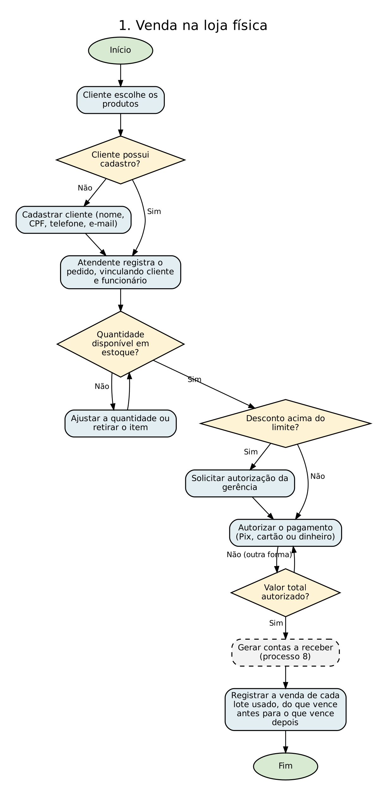

### 10.2 Venda na loja virtual

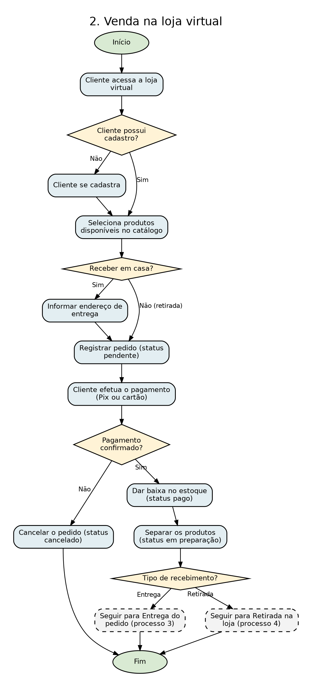

### 10.3 Entrega do pedido

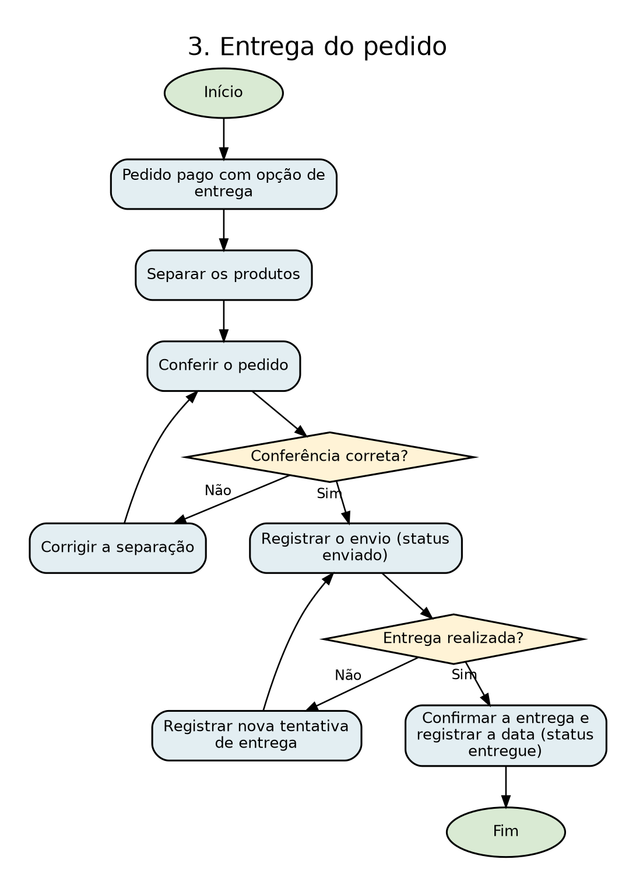

### 10.4 Retirada do pedido na loja

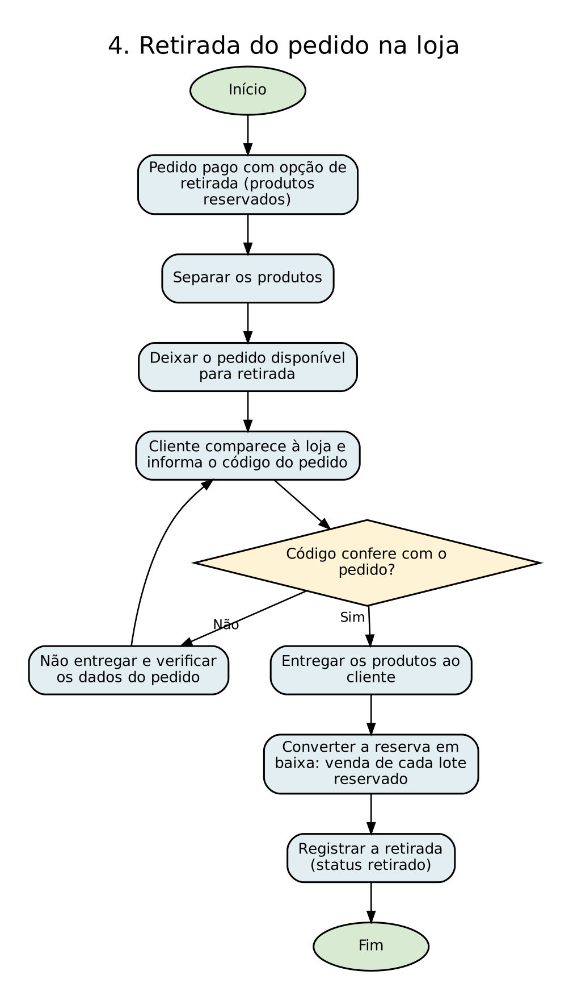

### 10.5 Controle de estoque

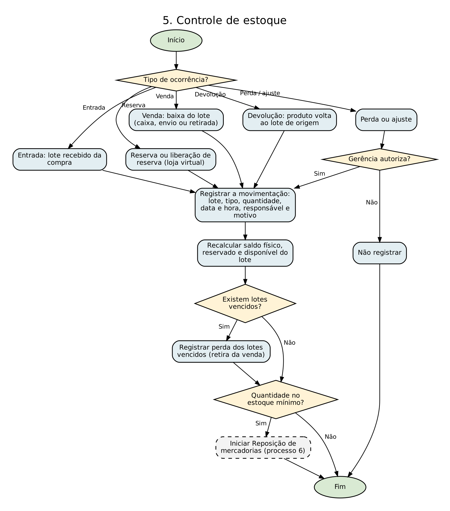

### 10.6 Reposição de mercadorias

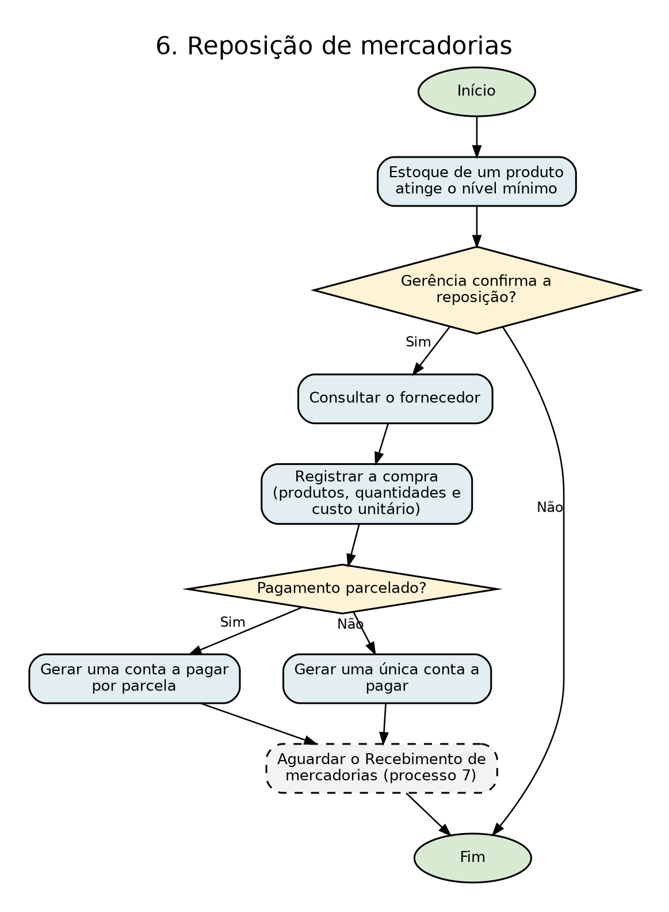

### 10.7 Recebimento de mercadorias

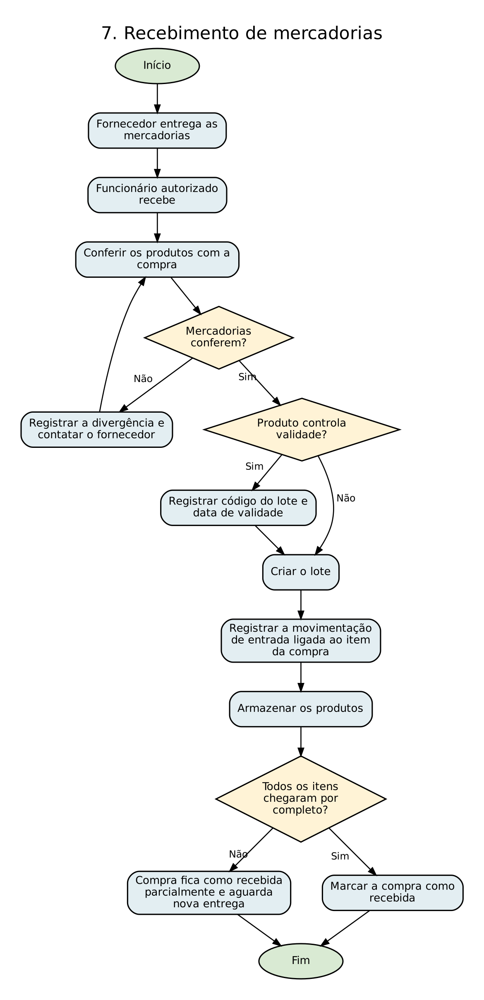

### 10.8 Pagamento da venda

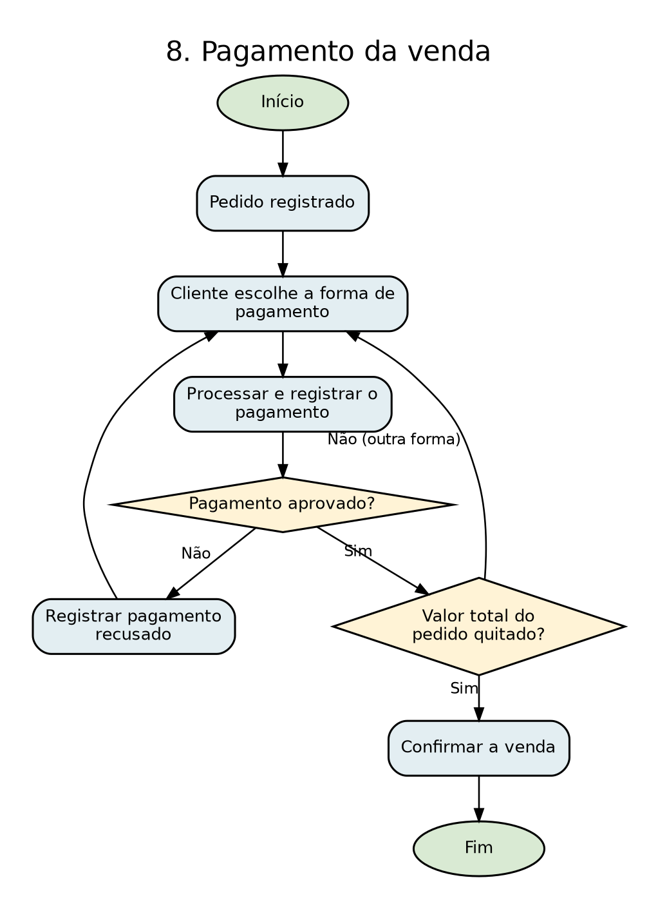

### 10.9 Controle financeiro

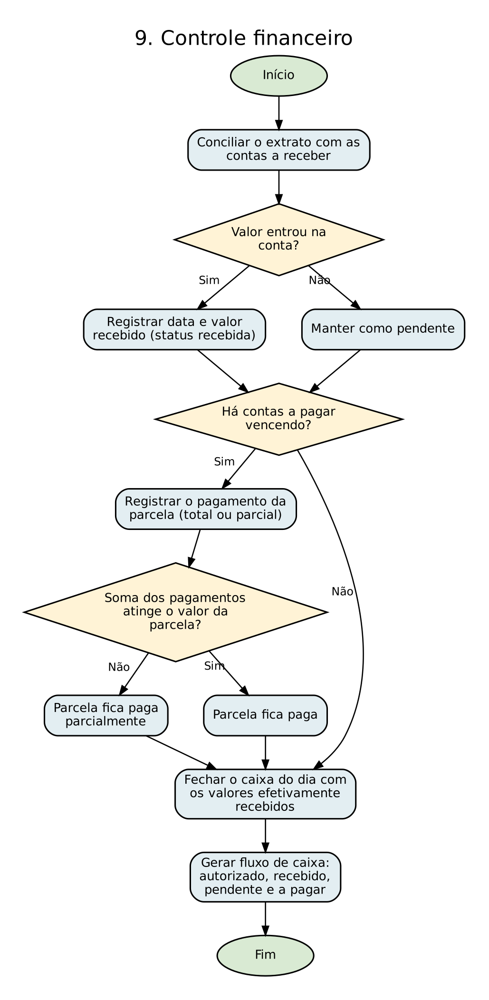

### 10.10 Cadastro de produtos

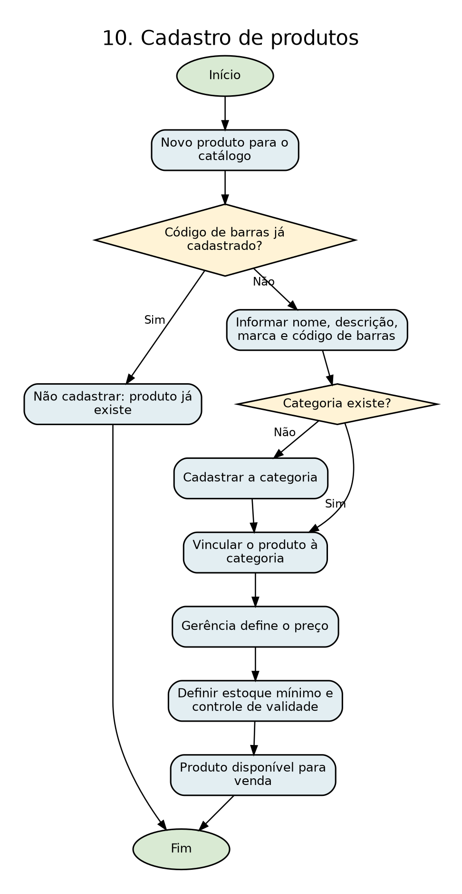

### 10.11 Cadastro de clientes

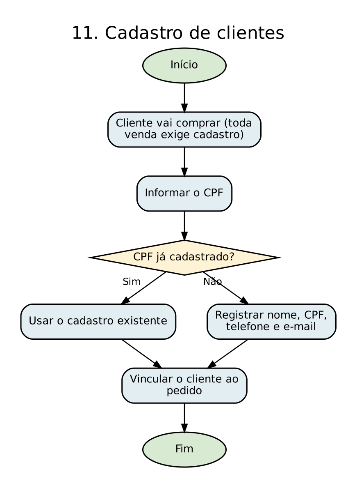

### 10.12 Cancelamento de pedido

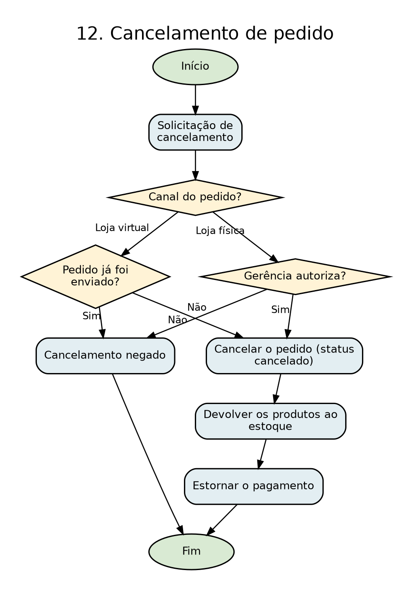

## 11. Entidades

O modelo possui 16 entidades, organizadas pelos processos da empresa.

### Entidades relacionadas aos clientes

**Cliente** (*Para cadastrar e identificar as pessoas que compram na loja física ou na loja virtual. Toda venda é vinculada a um cliente (RP02)*)

- ID do cliente;
- Nome;
- CPF;
- Telefone;
- E-mail;

### Entidades relacionadas aos produtos e ao estoque

**Produto** (*Para cadastrar os itens vendidos pela loja e seus preços*)

- ID do produto;
- Nome;
- Descrição;
- Marca;
- Código de barras;
- Preço;
- Estoque mínimo;
- Controla validade (sim ou não);
- Categoria;

**Categoria** (*Para organizar os produtos por tipo, sem repetir as informações da categoria em cada produto (RN04). Ex.: ração, petiscos, higiene, acessórios, brinquedos*)

- ID da categoria;
- Nome;
- Descrição;

**Lote** (*Para identificar cada lote de um produto guardado no estoque único das duas lojas, com a sua validade (RP01, RN11). Substitui a antiga entidade Estoque: o nome Lote deixa claro que cada registro é um lote, e não o estoque inteiro do produto*)

- ID do lote;
- Produto;
- Código do lote;
- Data de validade, quando aplicável;
- Data de entrada;
- Saldo físico (derivado);
- Quantidade reservada (derivado);
- Quantidade disponível (derivado);

**Movimentação de estoque** (*Para guardar o histórico de tudo o que entra, sai ou fica reservado em cada lote: entradas, reservas, liberações de reserva, vendas, devoluções, perdas e ajustes (RN19). É a partir dela que se sabe de qual lote saiu cada venda (RN20)*)

- ID da movimentação;
- Lote;
- Tipo (entrada, reserva, liberação de reserva, venda, devolução, perda, ajuste positivo ou ajuste negativo);
- Quantidade;
- Data e hora;
- Motivo;
- Funcionário responsável;
- Item do pedido (nas reservas, liberações, vendas e devoluções);
- Item da compra (nas entradas);

### Entidades relacionadas aos fornecedores e compras

**Fornecedor** (*Para a Petly Club saber de qual empresa compra seus produtos*)

- ID do fornecedor;
- Razão social;
- CNPJ;
- Telefone;
- E-mail;

**Compra** (*Para registrar as compras de reposição feitas a um fornecedor (RN10)*)

- ID da compra;
- Fornecedor;
- Data da compra;
- Status (solicitada, recebida parcialmente, recebida ou cancelada);
- Valor total (derivado);

**Item da compra** (*Para registrar quais produtos foram comprados em cada compra, com quantidade e custo. Resolve o N:N entre Compra e Produto*)

- Compra;
- Produto;
- Quantidade comprada;
- Custo unitário;
- Quantidade recebida (derivado);

**Conta a pagar** (*Para registrar as parcelas que a empresa deve aos fornecedores por cada compra (RN12)*)

- ID da conta;
- Compra;
- Número da parcela;
- Valor;
- Data de vencimento;
- Valor pago (derivado);
- Status (pendente, paga parcialmente, paga ou cancelada);

**Pagamento da conta** (*Para registrar cada pagamento feito em uma parcela, já que uma mesma parcela pode ser paga em mais de uma vez (RN23)*)

- ID do pagamento da conta;
- Conta a pagar;
- Valor pago;
- Data do pagamento;
- Forma de pagamento;

### Entidades relacionadas aos funcionários

**Funcionário** (*Para identificar quem trabalha na Petly Club, quem registra as vendas da loja física (RN14) e as movimentações de estoque (RN19), e o acesso de cada um ao sistema (RP08)*)

- ID do funcionário;
- Nome;
- CPF;
- Cargo;
- Login;
- Senha;

### Entidades relacionadas às vendas

**Pedido** (*Para registrar cada venda, feita na loja física ou na loja virtual (RN05)*)

- ID do pedido;
- Cliente;
- Funcionário (vendas da loja física);
- Data e hora;
- Canal de venda;
- Tipo de recebimento (balcão, retirada ou entrega);
- Status;
- Desconto;
- Valor total (derivado);

**Item do pedido** (*Para identificar quais produtos foram vendidos em cada pedido, com quantidade e preço praticado. Resolve o N:N entre Pedido e Produto (RN03, RN13)*)

- Pedido;
- Produto;
- Quantidade;
- Preço unitário;
- Subtotal (derivado);

**Pagamento** (*Para registrar a autorização de cada forma de pagamento usada no pedido; um pedido pode ter mais de uma forma de pagamento (RN15)*)

- ID do pagamento;
- Pedido;
- Forma de pagamento;
- Valor;
- Número de parcelas;
- Data da autorização;
- Status (pendente, autorizado, recusado ou estornado);

**Conta a receber** (*Para registrar quando o dinheiro de cada pagamento autorizado entra de fato na conta da empresa, separando o que já foi recebido do que ainda está pendente (RN24)*)

- ID da conta a receber;
- Pagamento;
- Número da parcela;
- Valor bruto;
- Valor líquido;
- Data prevista;
- Data do recebimento;
- Status (pendente, recebida ou cancelada);

### Entidades relacionadas às entregas

**Entrega** (*Para controlar os pedidos da loja virtual enviados para a casa do cliente (RN17)*)

- ID da entrega;
- Pedido;
- Endereço de entrega (logradouro, número, complemento, bairro, cidade, UF, CEP);
- Data prevista;
- Data da entrega;
- Status;

### Itens analisados que não viraram entidades

**Pet, Cadastro do pet, Serviço, Agendamento, Atendimento, Tabela de preços, Veterinário, Consulta, Prontuário, Vacinação e Prescrição:** A empresa não oferece banho e tosa, atendimento veterinário nem venda de animais (RP10). O sistema contempla apenas a comercialização de produtos.

**Endereço:** Só é necessário quando o pedido é entregue; foi registrado como atributo composto de Entrega.

**Forma de pagamento:** É um valor fixo (dinheiro, Pix, cartão de débito ou crédito); foi registrada como atributo de Pagamento e de Pagamento da conta.

**Cargo e Perfil de acesso:** O cargo define o acesso ao sistema (RP08); foi registrado como atributo de Funcionário.

**Usuário e Permissão:** O acesso é feito pelo próprio funcionário, com login e senha registrados em Funcionário.

**Histórico do cliente:** É obtido pela consulta aos pedidos do cliente; não precisa ser armazenado separadamente.

**Reserva:** Não virou entidade própria. Uma reserva é uma movimentação do tipo "reserva" ligada ao item do pedido e ao lote; ao ser liberada ou convertida em venda, gera outra movimentação. Assim, todo o ciclo do produto fica no mesmo histórico.

**Produto do fornecedor:** O vínculo entre fornecedor e produto já fica registrado por meio de Compra e Item da compra.

**Nota fiscal e Recebimento da compra:** A compra de reposição já registra fornecedor, data, produtos e valores, e cada entrega do fornecedor fica registrada pelas movimentações de entrada ligadas ao item da compra.

**Entregador, Escala, Comissão e Log do sistema:** Não fazem parte do escopo desta etapa do projeto; não há regras de negócio que exijam essas informações.

## 12. Atributos

| Entidade | Atributos | PK | FK |
|---|---|---|---|
| CLIENTE | id_cliente, nome, cpf, telefone, email | id_cliente | nenhuma |
| FUNCIONÁRIO | id_funcionario, nome, cpf, cargo, login, senha | id_funcionario | nenhuma |
| CATEGORIA | id_categoria, nome, descricao | id_categoria | nenhuma |
| PRODUTO | id_produto, nome, descricao, marca, codigo_barras, preco, estoque_minimo, controla_validade, id_categoria | id_produto | id_categoria → CATEGORIA |
| LOTE | id_lote, codigo_lote, data_entrada, data_validade, saldo_fisico (derivado: soma das movimentações que entram menos as que saem), quantidade_reservada (derivado: reservas ainda não liberadas nem baixadas), quantidade_disponivel (derivado: saldo_fisico − quantidade_reservada), id_produto | id_lote | id_produto → PRODUTO |
| MOVIMENTACAO_ESTOQUE | id_movimentacao, tipo, quantidade, data_hora, motivo, id_lote, id_funcionario, id_pedido + id_produto (item do pedido), id_compra + id_produto (item da compra) | id_movimentacao | id_lote → LOTE; id_funcionario → FUNCIONÁRIO (opcional nas operações automáticas da loja virtual); id_pedido + id_produto → ITEM_PEDIDO (nas reservas, liberações, vendas e devoluções); id_compra + id_produto → ITEM_COMPRA (nas entradas) |
| FORNECEDOR | id_fornecedor, razao_social, cnpj, telefone, email | id_fornecedor | nenhuma |
| COMPRA | id_compra, data_compra, status, valor_total (derivado: soma de quantidade_comprada × custo_unitario dos itens), id_fornecedor | id_compra | id_fornecedor → FORNECEDOR |
| ITEM_COMPRA | id_compra, id_produto, quantidade_comprada, custo_unitario, quantidade_recebida (derivado: soma das movimentações de entrada do item) | id_compra + id_produto (composta) | id_compra → COMPRA; id_produto → PRODUTO |
| CONTA_PAGAR | id_conta_pagar, numero_parcela, valor, data_vencimento, valor_pago (derivado: soma dos pagamentos da conta), status, id_compra | id_conta_pagar | id_compra → COMPRA |
| PAGAMENTO_CONTA | id_pagamento_conta, valor_pago, data_pagamento, forma_pagamento, id_conta_pagar | id_pagamento_conta | id_conta_pagar → CONTA_PAGAR |
| PEDIDO | id_pedido, data_pedido, canal_venda, tipo_recebimento, status, desconto, valor_total (derivado: soma dos subtotais dos itens menos o desconto), id_cliente, id_funcionario | id_pedido | id_cliente → CLIENTE; id_funcionario → FUNCIONÁRIO (opcional nos pedidos da loja virtual) |
| ITEM_PEDIDO | id_pedido, id_produto, quantidade, preco_unitario, subtotal (derivado: quantidade × preco_unitario) | id_pedido + id_produto (composta) | id_pedido → PEDIDO; id_produto → PRODUTO |
| PAGAMENTO | id_pagamento, forma_pagamento, valor, numero_parcelas, data_autorizacao, status, id_pedido | id_pagamento | id_pedido → PEDIDO |
| CONTA_RECEBER | id_conta_receber, numero_parcela, valor_bruto, valor_liquido, data_prevista, data_recebimento, status, id_pagamento | id_conta_receber | id_pagamento → PAGAMENTO |
| ENTREGA | id_entrega, endereco_entrega (composto: logradouro, numero, complemento, bairro, cidade, uf, cep), data_prevista, data_entrega, status, id_pedido | id_entrega | id_pedido → PEDIDO (não se repete) |

## 13. Relacionamentos

| Relacionamento | Cardinalidade | Implementação |
|---|---|---|
| CLIENTE — REALIZA — PEDIDO | 1:N | id_cliente migra para PEDIDO como FK. |
| FUNCIONÁRIO — REGISTRA — PEDIDO | 1:N | id_funcionario migra para PEDIDO como FK (opcional nos pedidos da loja virtual). |
| PEDIDO — CONTÉM — PRODUTO | N:N | Resolvido pela associativa ITEM_PEDIDO (quantidade, preco_unitario). |
| PEDIDO — POSSUI — PAGAMENTO | 1:N | id_pedido migra para PAGAMENTO como FK. |
| PAGAMENTO — GERA — CONTA_RECEBER | 1:N | id_pagamento migra para CONTA_RECEBER como FK; cada parcela a receber é um registro. |
| PEDIDO — GERA — ENTREGA | 1:1 opcional | id_pedido migra para ENTREGA como FK e não se repete (no máximo uma entrega por pedido). |
| CATEGORIA — CLASSIFICA — PRODUTO | 1:N | id_categoria migra para PRODUTO como FK. |
| PRODUTO — POSSUI — LOTE | 1:N | id_produto migra para LOTE como FK; cada lote é um registro. |
| LOTE — SOFRE — MOVIMENTACAO_ESTOQUE | 1:N | id_lote migra para MOVIMENTACAO_ESTOQUE como FK; cada movimentação é um registro do histórico. |
| ITEM_PEDIDO — ORIGINA — MOVIMENTACAO_ESTOQUE | 1:N | id_pedido + id_produto migram para MOVIMENTACAO_ESTOQUE como FK; um item pode gerar reserva, venda, liberação e devolução, e pode usar mais de um lote. |
| ITEM_COMPRA — ORIGINA — MOVIMENTACAO_ESTOQUE | 1:N | id_compra + id_produto migram para MOVIMENTACAO_ESTOQUE como FK; cada entrega recebida gera uma movimentação de entrada. |
| FUNCIONÁRIO — REGISTRA — MOVIMENTACAO_ESTOQUE | 1:N | id_funcionario migra para MOVIMENTACAO_ESTOQUE como FK (opcional nas operações automáticas da loja virtual). |
| FORNECEDOR — ATENDE — COMPRA | 1:N | id_fornecedor migra para COMPRA como FK. |
| COMPRA — REPÕE — PRODUTO | N:N | Resolvido pela associativa ITEM_COMPRA (quantidade_comprada, custo_unitario). |
| FORNECEDOR — FORNECE — PRODUTO | N:N | Resolvido por COMPRA e ITEM_COMPRA, sem ligação direta entre FORNECEDOR e PRODUTO. |
| COMPRA — GERA — CONTA_PAGAR | 1:N | id_compra migra para CONTA_PAGAR como FK; cada parcela é um registro. |
| PAGAMENTO_CONTA — QUITA — CONTA_PAGAR | N:1 | id_conta_pagar migra para PAGAMENTO_CONTA como FK; cada pagamento da parcela é um registro. |

### 13.1 Verificação de atributos nos relacionamentos

**Relacionamento:** CLIENTE — REALIZA — PEDIDO

**Tipo:** 1:N

**Regra:** RN01, RN02, RP02

**Possui atributos próprios?** Não

**Resultado:** FK id_cliente em PEDIDO

**Relacionamento:** FUNCIONÁRIO — REGISTRA — PEDIDO

**Tipo:** 1:N

**Regra:** RN14

**Possui atributos próprios?** Não

**Resultado:** FK id_funcionario em PEDIDO

**Relacionamento:** PEDIDO — POSSUI — PAGAMENTO

**Tipo:** 1:N

**Regra:** RN15

**Possui atributos próprios?** Não

**Resultado:** FK id_pedido em PAGAMENTO

**Relacionamento:** PAGAMENTO — GERA — CONTA_RECEBER

**Tipo:** 1:N

**Regra:** RN24

**Possui atributos próprios?** Não

**Resultado:** FK id_pagamento em CONTA_RECEBER

**Relacionamento:** PEDIDO — GERA — ENTREGA

**Tipo:** 1:1 opcional

**Regra:** RN17

**Possui atributos próprios?** Não

**Resultado:** FK id_pedido em ENTREGA

**Relacionamento:** CATEGORIA — CLASSIFICA — PRODUTO

**Tipo:** 1:N

**Regra:** RN04

**Possui atributos próprios?** Não

**Resultado:** FK id_categoria em PRODUTO

**Relacionamento:** PRODUTO — POSSUI — LOTE

**Tipo:** 1:N

**Regra:** RN11

**Possui atributos próprios?** Não

**Resultado:** FK id_produto em LOTE

**Relacionamento:** LOTE — SOFRE — MOVIMENTACAO_ESTOQUE

**Tipo:** 1:N

**Regra:** RN19

**Possui atributos próprios?** Não

**Resultado:** FK id_lote em MOVIMENTACAO_ESTOQUE

**Relacionamento:** ITEM_PEDIDO — ORIGINA — MOVIMENTACAO_ESTOQUE

**Tipo:** 1:N

**Regra:** RN20, RN21, RN22

**Possui atributos próprios?** Não

**Resultado:** FK id_pedido + id_produto em MOVIMENTACAO_ESTOQUE

**Relacionamento:** ITEM_COMPRA — ORIGINA — MOVIMENTACAO_ESTOQUE

**Tipo:** 1:N

**Regra:** RN08, RN25

**Possui atributos próprios?** Não

**Resultado:** FK id_compra + id_produto em MOVIMENTACAO_ESTOQUE

**Relacionamento:** FUNCIONÁRIO — REGISTRA — MOVIMENTACAO_ESTOQUE

**Tipo:** 1:N

**Regra:** RN19, RP06, RP11

**Possui atributos próprios?** Não

**Resultado:** FK id_funcionario em MOVIMENTACAO_ESTOQUE

**Relacionamento:** FORNECEDOR — ATENDE — COMPRA

**Tipo:** 1:N

**Regra:** RN10

**Possui atributos próprios?** Não

**Resultado:** FK id_fornecedor em COMPRA

**Relacionamento:** COMPRA — GERA — CONTA_PAGAR

**Tipo:** 1:N

**Regra:** RN12

**Possui atributos próprios?** Não

**Resultado:** FK id_compra em CONTA_PAGAR

**Relacionamento:** PAGAMENTO_CONTA — QUITA — CONTA_PAGAR

**Tipo:** N:1

**Regra:** RN23

**Possui atributos próprios?** Não

**Resultado:** FK id_conta_pagar em PAGAMENTO_CONTA

**Relacionamento:** PEDIDO — CONTÉM — PRODUTO

**Tipo:** N:N

**Regra:** RN03, RN13

**Possui atributos próprios?** Sim

**Resultado:** ITEM_PEDIDO

**Relacionamento:** COMPRA — REPÕE — PRODUTO

**Tipo:** N:N

**Regra:** RN10

**Possui atributos próprios?** Sim

**Resultado:** ITEM_COMPRA

**Relacionamento:** FORNECEDOR — FORNECE — PRODUTO

**Tipo:** N:N

**Regra:** RN09

**Possui atributos próprios?** Não (resolvido por Compra)

**Resultado:** Sem linha direta no DER

#### Relacionamentos sem atributos próprios

**Cliente — Pedido:** data_pedido, canal_venda, tipo_recebimento e status descrevem o pedido, não a ligação com o cliente.

**Funcionário — Pedido:** o funcionário só aparece como responsável pelo registro da venda; o momento do registro coincide com a data do pedido.

**Pedido — Pagamento:** valor, forma de pagamento, número de parcelas, data da autorização e status descrevem o pagamento. A forma de pagamento é atributo de PAGAMENTO, não entidade própria. Como um pedido pode ter vários pagamentos (RN15), a relação é 1:N e PAGAMENTO é uma entidade normal, não associativa.

**Pagamento — Conta_Receber:** número da parcela, valores, datas e status descrevem cada valor a receber. O pagamento registra a autorização, e a conta a receber registra quando o dinheiro entra de fato (RN24).

**Pedido — Entrega:** o endereço de entrega (logradouro, número, complemento, bairro, cidade, UF e CEP) é atributo composto de ENTREGA. Não existe entidade Endereço. A relação é 1:1 opcional porque vendas no balcão e pedidos da loja virtual retirados na loja não geram entrega (RN17).

**Categoria — Produto:** o nome e a descrição da categoria pertencem à categoria, e o produto guarda só o id_categoria.

**Produto — Lote:** o estoque é controlado por lote, então um produto tem vários lotes. Código do lote, validade e data de entrada descrevem o lote, não o par Produto+Lote.

**Lote — Movimentação, Item_Pedido — Movimentação, Item_Compra — Movimentação e Funcionário — Movimentação:** tipo, quantidade, data e hora e motivo descrevem a própria movimentação. Por isso, MOVIMENTACAO_ESTOQUE é uma entidade comum, ligada a cada um desses lados por um relacionamento 1:N, e não uma associativa. É ela que liga cada venda ao lote de onde as unidades saíram (RN20).

**Fornecedor — Compra:** data, valor_total e status descrevem a compra.

**Compra — Conta_Pagar:** número da parcela, valor, vencimento e status descrevem cada conta a pagar, não a ligação com a compra (RN12).

**Conta_Pagar — Pagamento_Conta:** valor pago, data e forma de pagamento descrevem cada pagamento feito na parcela (RN23).

#### Relacionamentos com atributos

#### PEDIDO — CONTÉM — PRODUTO → ITEM_PEDIDO (RN03)

**Por que é N:N:** um pedido contém vários produtos, e um produto aparece em vários pedidos.

**Atributos do relacionamento:** quantidade e preco_unitario.

**Por que pertencem à relação:** a quantidade só existe quando se sabe qual produto foi vendido em qual pedido. Em PEDIDO seria preciso repetir campos (produto1, produto2…), e em PRODUTO não daria para saber a quantidade de cada venda.

**Por que preco_unitario não fica só em Produto:** o preço do produto pode mudar, mas o valor cobrado naquela venda precisa ficar registrado (RN13).

**Subtotal:** não é armazenado, por ser derivado (quantidade × preco_unitario).

**Lotes do item:** os lotes de onde saíram as unidades não ficam no item, porque um mesmo item pode usar mais de um lote. Eles ficam nas movimentações ligadas ao item (RN20).

**Identificação:** PK composta id_pedido + id_produto.

#### COMPRA — REPÕE — PRODUTO → ITEM_COMPRA (RN10)

**Por que é N:N:** uma compra de reposição traz vários produtos, e um produto é comprado em várias compras.

**Atributos do relacionamento:** quantidade_comprada e custo_unitario.

**Por que pertencem à relação:** o custo varia a cada compra, então não pode ficar só em PRODUTO. Isso preserva o histórico de custos e permite calcular margem.

**Quantidade recebida:** é derivada da soma das movimentações de entrada ligadas ao item, o que permite registrar uma compra recebida em mais de uma entrega (RN25).

**Lote e validade:** ficam em LOTE, no momento da entrada (RN11), e não em ITEM_COMPRA.

**Identificação:** PK composta id_compra + id_produto.

#### FORNECEDOR — FORNECE — PRODUTO (RN09): N:N resolvido por Compra

Um produto pode ter vários fornecedores, e um fornecedor fornece vários produtos, então a relação é N:N. Ela não vira entidade associativa própria porque já é resolvida por COMPRA e ITEM_COMPRA. No DER o caminho é Fornecedor → Compra → Item_Compra ← Produto, sem linha direta entre Fornecedor e Produto.

Por isso não existe Produto_Fornecedor. O preço que cada fornecedor cobra fica registrado no custo_unitario de ITEM_COMPRA. Atributos como prazo_entrega e codigo_produto_fornecedor só seriam necessários se o grupo decidisse guardar um catálogo de fornecedores, o que não está no escopo.

## 14. Cardinalidades

Nós adotamos a notação (mínimo e máximo) ao lado de cada entidade, indicando em quantas ocorrências de um relacionamento uma ocorrência daquela entidade pode participar.

| Relacionamento | Cardinalidade | Justificativa (regra de negócio) |
|---|---|---|
| Cliente – Pedido | 1:N. Cliente (0,N), Pedido (1,1) | Um cliente pode fazer vários pedidos ou nenhum, caso esteja apenas cadastrado (RN01, RN02). Todo pedido pertence a exatamente um cliente, pois o CPF identifica o tutor, inclusive na loja física (RP02). |
| Funcionário – Pedido | 1:N. Funcionário (0,N), Pedido (0,1) | Um funcionário registra vários pedidos (RN14). Na loja virtual a compra é feita pelo próprio cliente, sem atendente, por isso o mínimo do lado do pedido é 0. |
| Pedido – Pagamento | 1:N. Pedido (1,N), Pagamento (1,1) | Um pedido pode ser pago de mais de uma forma, então pode ter vários pagamentos, e todo pedido tem ao menos um pagamento associado (RN15). Cada pagamento refere-se a um único pedido. |
| Pagamento – Conta_Receber | 1:N. Pagamento (0,N), Conta_Receber (1,1) | Um pagamento autorizado gera uma conta a receber, ou até três no crédito parcelado (RN24). Um pagamento pendente ou recusado não gera nenhuma, por isso o mínimo é 0. Cada conta a receber pertence a um único pagamento. |
| Pedido – Entrega | 1:1 opcional. Pedido (0,1), Entrega (1,1) | Um pedido tem no máximo uma entrega (RN17). Vendas no balcão e pedidos da loja virtual retirados na loja não têm entrega, por isso o mínimo do lado do pedido é 0. Toda entrega pertence a exatamente um pedido. |
| Categoria – Produto | 1:N. Categoria (0,N), Produto (1,1) | Uma categoria pode agrupar vários produtos ou ainda não ter nenhum. Cada produto pertence a uma única categoria (RN04). |
| Pedido – Item_Pedido | 1:N. Pedido (1,N), Item_Pedido (1,1) | Um pedido só existe com pelo menos um item (RN03). Cada item pertence a um único pedido. |
| Produto – Item_Pedido | 1:N. Produto (0,N), Item_Pedido (1,1) | Um produto pode aparecer em vários itens de pedido, ou em nenhum se nunca foi vendido (RN03). Cada item refere-se a um único produto. |
| Produto – Lote | 1:N. Produto (0,N), Lote (1,1) | O estoque é único para as duas lojas (RP01) e controlado por lote (RN11). Um produto pode ter vários lotes, ou nenhum se ainda não foi recebido. Cada lote pertence a um único produto. |
| Lote – Movimentação_Estoque | 1:N. Lote (1,N), Movimentação (1,1) | Todo lote nasce de uma movimentação de entrada e acumula todas as movimentações seguintes (RN19). Cada movimentação refere-se a um único lote. |
| Item_Pedido – Movimentação_Estoque | 1:N. Item_Pedido (1,N), Movimentação (0,1) | Todo item vendido gera pelo menos uma movimentação: a reserva, na loja virtual, ou a venda, na loja física (RN21). Ele pode gerar várias quando sai de mais de um lote (RN20) ou quando é cancelado (RN22). Movimentações de entrada, perda ou ajuste não têm item de pedido, por isso o mínimo do outro lado é 0. |
| Item_Compra – Movimentação_Estoque | 1:N. Item_Compra (0,N), Movimentação (0,1) | Um item comprado pode ainda não ter chegado (nenhuma entrada) ou ter chegado em várias entregas (RN25). Só as movimentações de entrada têm item de compra. |
| Funcionário – Movimentação_Estoque | 1:N. Funcionário (0,N), Movimentação (0,1) | Um funcionário registra várias movimentações (RN19, RP06, RP11). Reservas e liberações automáticas da loja virtual não têm funcionário responsável. |
| Fornecedor – Compra | 1:N. Fornecedor (0,N), Compra (1,1) | Um fornecedor pode atender várias compras, ou nenhuma se acabou de ser cadastrado. Cada compra é feita a um único fornecedor (RN10). |
| Compra – Item_Compra | 1:N. Compra (1,N), Item_Compra (1,1) | Toda compra tem ao menos um item (RN10). Cada item pertence a uma única compra. |
| Produto – Item_Compra | 1:N. Produto (0,N), Item_Compra (1,1) | Um produto pode ser reposto em várias compras, ou em nenhuma se ainda não foi comprado. Cada item de compra refere-se a um único produto (RN10). |
| Compra – Conta_Pagar | 1:N. Compra (1,N), Conta_Pagar (1,1) | Toda compra gera pelo menos uma conta a pagar, podendo ser dividida em parcelas (RN12). Cada conta pertence a uma única compra. |
| Conta_Pagar – Pagamento_Conta | 1:N. Conta_Pagar (0,N), Pagamento_Conta (1,1) | Uma parcela pode ainda não ter sido paga ou ter sido paga em uma ou mais vezes (RN23). Cada pagamento refere-se a uma única parcela. |

Nos relacionamentos 1:N, a chave primária do lado 1 migra como chave estrangeira (FK) para o lado N. Em Funcionário–Pedido e Funcionário–Movimentação, a FK id_funcionario é opcional (aceita nulo), por causa das operações automáticas da loja virtual. No 1:1 Pedido–Entrega, a FK id_pedido fica em ENTREGA, que é o lado de participação obrigatória, com restrição de unicidade (UNIQUE), garantindo no máximo uma entrega por pedido.

Em Pedido–Pagamento, a cardinalidade mínima do lado do pedido é 1: todo pedido possui ao menos um pagamento associado desde o seu registro (RN15). Na loja virtual, o pagamento pode ficar com status pendente até a confirmação, mas o registro do pagamento existe. Assim, a situação "aguardando pagamento" é controlada pelo status do próprio pagamento, e não pela ausência dele. Já o dinheiro que entrou de fato é controlado pelas contas a receber (RN24).

O endereço de entrega foi registrado como atributo composto da entidade Entrega (logradouro, número, complemento, bairro, cidade, UF e CEP), pois só é necessário quando o pedido é entregue na casa do cliente. Por isso, não foi criada uma entidade Endereço.

### 14.1 Relacionamentos N:N

Analisamos cada par de entidades verificando se ocorre "muitos" nos dois sentidos. Foram encontrados três relacionamentos N:N, apresentados com a cardinalidade mínima e máxima de cada lado:

| Relacionamento N:N | Cardinalidade | Regra que sustenta |
|---|---|---|
| Pedido – Produto | Pedido (1,N) — contém — Produto (0,N) | Um pedido contém no mínimo um produto e pode conter vários. Um produto pode não estar em nenhum pedido (nunca vendido) ou estar em vários (RN03). |
| Compra – Produto | Compra (1,N) — repõe — Produto (0,N) | Uma compra traz no mínimo um produto e pode trazer vários. Um produto pode nunca ter sido comprado ou ter sido reposto em várias compras (RN10). |
| Fornecedor – Produto | Fornecedor (0,N) — fornece — Produto (0,N) | Um fornecedor recém-cadastrado pode não ter fornecido nada, e pode fornecer vários produtos. Um produto pode não ter fornecedor registrado e pode ser fornecido por vários (RN09). |

**Pedido × Produto.** Um pedido contém vários produtos, e um produto pode estar em vários pedidos. O N:N foi resolvido pela entidade associativa **Item_Pedido**, com chave primária composta por id_pedido e id_produto (ambas também FKs). Os atributos do relacionamento são quantidade e preco_unitario, este último guardando o preço praticado na data da venda, para que uma alteração posterior no preço do produto não modifique pedidos antigos (RN13). O subtotal não é armazenado, pois é derivado (quantidade × preco_unitario). Após a resolução, o relacionamento passa a ser Pedido (1,N) – Item_Pedido (1,1) e Produto (0,N) – Item_Pedido (1,1), como mostra a seção 13.

**Compra × Produto.** Uma compra de reposição traz vários produtos, e um produto é reposto em várias compras. O N:N foi resolvido pela entidade associativa **Item_Compra**, com os atributos quantidade_comprada e custo_unitario. A chave primária é composta por id_compra e id_produto (ambas também FKs), pois cada produto aparece uma única vez em cada compra, com a quantidade total adquirida. Lote e validade não pertencem ao Item_Compra: ficam registrados na entidade Lote (RN11). Se a compra chegar em mais de uma entrega, cada entrega gera uma movimentação de entrada ligada ao mesmo item (RN25). Por isso não é necessário incluir o lote na chave, e a PK composta está definida.

**Lote × Item_Pedido (verificado e descartado como N:N direto).** Um item vendido pode sair de vários lotes, e um lote abastece vários itens vendidos, o que forma um "muitos" nos dois sentidos. Esse vínculo não ganhou uma associativa própria porque já é resolvido por **Movimentação_Estoque**: cada movimentação de venda liga um item a um lote e guarda a quantidade retirada daquele lote (RN20). Além da venda, a mesma entidade registra reservas, liberações e devoluções do item, mantendo o ciclo completo no mesmo histórico.

**Fornecedor × Produto.** Conceitualmente, um fornecedor pode fornecer vários produtos e um produto pode ser fornecido por vários fornecedores (RN09). Em vez de criar uma associativa direta entre as duas entidades, o grupo decidiu representar o vínculo pelo processo de Compra, que registra a situação definitiva: a empresa comprou determinados produtos de determinado fornecedor. O caminho fica:

```
FORNECEDOR ──1:N──► COMPRA ──1:N──► ITEM_COMPRA ◄──N:1── PRODUTO
```

Exemplo: o Fornecedor X vende Ração A, Ração B e Petisco C. Na Compra nº 125, feita a esse fornecedor, os itens registrados são 50 × Ração A, 30 × Ração B e 20 × Petisco C. Assim, o vínculo entre produto e fornecedor fica documentado com data, quantidade e custo unitário, informações que uma tabela de ligação simples não guardaria. Uma tabela Produto_Fornecedor duplicaria essa informação e só se justificaria se a loja passasse a manter um cadastro de fornecedores habilitados por produto, com preço de tabela e prazo de entrega, o que fica como possível evolução do modelo.

Os demais relacionamentos (Cliente–Pedido, Funcionário–Pedido, Pedido–Pagamento, Pagamento–Conta_Receber, Pedido–Entrega, Categoria–Produto, Produto–Lote, Lote–Movimentação, Funcionário–Movimentação, Fornecedor–Compra, Compra–Conta_Pagar e Conta_Pagar–Pagamento_Conta) não são N:N e não exigem entidade associativa. Pedido–Entrega é 1:1 opcional; os outros são 1:N.

## 15. Dicionário de dados conceitual

| Entidade | Descrição | Principais atributos |
|---|---|---|
| Cliente | Pessoa física (tutor) que realiza compras na loja física ou virtual. | id_cliente, nome, CPF, telefone, e-mail |
| Funcionário | Colaborador que registra vendas e movimentações de estoque. | id_funcionario, nome, CPF, cargo, login, senha |
| Categoria | Classificação dos produtos vendidos. | id_categoria, nome, descrição |
| Produto | Produto comercializado pela empresa. | id_produto, nome, descrição, marca, código de barras, preço, estoque_minimo, controla_validade |
| Lote | Lote de um produto no estoque único das duas lojas. | id_lote, código do lote, data_validade, data_entrada, saldo_fisico, quantidade_reservada, quantidade_disponivel |
| Movimentação_Estoque | Histórico de entradas, reservas, liberações, vendas, devoluções, perdas e ajustes de cada lote. | id_movimentacao, tipo, quantidade, data_hora, motivo |
| Pedido | Venda realizada na loja física ou na loja virtual. | id_pedido, data, canal_venda, tipo_recebimento, status, desconto, valor_total |
| Item_Pedido | Produtos que fazem parte de um pedido. | id_pedido, id_produto, quantidade, preço_unitario, subtotal |
| Pagamento | Autorização de cada forma de pagamento usada no pedido. | id_pagamento, forma, valor, número de parcelas, data da autorização, status |
| Conta_Receber | Valor a receber gerado por um pagamento autorizado. | id_conta_receber, número da parcela, valor bruto, valor líquido, data prevista, data do recebimento, status |
| Entrega | Informações da entrega dos pedidos da loja virtual. | id_entrega, endereço_entrega, data_prevista, data_entrega, status |
| Fornecedor | Empresa que abastece a loja com mercadorias. | id_fornecedor, razão social, CNPJ, telefone, e-mail |
| Compra | Compra de reposição feita a um fornecedor. | id_compra, data, status, valor_total |
| Item_Compra | Produtos que fazem parte de uma compra. | id_compra, id_produto, quantidade comprada, custo_unitario, quantidade recebida |
| Conta_Pagar | Parcela a pagar gerada por uma compra. | id_conta_pagar, número da parcela, valor, vencimento, valor pago, status |
| Pagamento_Conta | Cada pagamento feito em uma parcela de conta a pagar. | id_pagamento_conta, valor pago, data do pagamento, forma de pagamento |

Observação: o dicionário é preliminar, portanto os atributos podem ser ajustados durante as etapas de modelo lógico, normalização e validação. Atributos marcados como **derivados** são calculados a partir de outros dados e não precisam ser armazenados.

### Cliente

Pessoa física (tutor de animal) que compra na loja física ou na loja virtual.

| Atributo | Descrição | Regra/Observação |
|---|---|---|
| id_cliente | Identificador do cliente | Identificação única |
| nome | Nome completo do cliente | Obrigatório |
| cpf | Documento do cliente | Obrigatório; não pode se repetir (RN18) |
| telefone | Telefone de contato | Pode ser informado posteriormente |
| email | E-mail de contato | Obrigatório para compras na loja virtual |

### Funcionário

Colaborador que registra vendas e movimentações de estoque.

| Atributo | Descrição | Regra/Observação |
|---|---|---|
| id_funcionario | Identificador do funcionário | Identificação única |
| nome | Nome completo | Obrigatório |
| cpf | Documento do funcionário | Obrigatório; não pode se repetir |
| cargo | Função exercida | Ex.: atendente, operador de caixa, estoquista, gerente; define o acesso ao sistema (RP08) |
| login | Nome de acesso ao sistema | Obrigatório; não pode se repetir |
| senha | Senha de acesso ao sistema | Obrigatória; armazenada com algoritmo de hash (RNF02) |

### Categoria

Classificação dos produtos vendidos (alimentação, higiene, acessórios etc.).

| Atributo | Descrição | Regra/Observação |
|---|---|---|
| id_categoria | Identificador da categoria | Identificação única |
| nome | Nome da categoria | Obrigatório; não pode se repetir |
| descricao | Descrição da categoria | Opcional |

### Produto

Produto comercializado pela empresa.

| Atributo | Descrição | Regra/Observação |
|---|---|---|
| id_produto | Identificador do produto | Identificação única |
| nome | Nome comercial do produto | Obrigatório |
| descricao | Detalhes do produto (peso, sabor, espécie indicada) | Opcional |
| marca | Marca ou fabricante | Obrigatório |
| codigo_barras | Código de barras do produto | Não pode se repetir; usado para localizar o produto no caixa (RNF05) |
| preco | Preço atual de venda | Obrigatório; maior que zero; só a gerência pode alterar (RP04) |
| estoque_minimo | Quantidade mínima desejada em estoque | Ao ser atingida, deve ser feita a reposição (RP03) |
| controla_validade | Indica se o produto exige controle de lote e validade | Sim ou não; quando sim, lote e validade são obrigatórios no estoque (RN11) |
| id_categoria | Categoria à qual o produto pertence | Obrigatório; todo produto pertence a uma categoria (RN04) |

### Lote

Cada lote de um produto guardado no estoque único compartilhado pela loja física e pela loja virtual (RP01). Substitui a antiga entidade Estoque.

| Atributo | Descrição | Regra/Observação |
|---|---|---|
| id_lote | Identificador do lote | Identificação única |
| id_produto | Produto do lote | Obrigatório |
| codigo_lote | Código do lote informado pelo fabricante | Obrigatório para produtos com controle de validade (RN11) |
| data_validade | Data de validade do lote | Obrigatória para produtos com controle de validade; lotes vencidos saem da venda por movimentação de perda (RP09) |
| data_entrada | Data de entrada do lote no estoque | Obrigatória |
| saldo_fisico | Quantidade que está fisicamente no estoque | **Derivado:** soma das entradas, devoluções e ajustes positivos menos as vendas, perdas e ajustes negativos do lote (RN19); não pode ser negativo |
| quantidade_reservada | Quantidade separada para pedidos da loja virtual | **Derivado:** reservas do lote ainda não liberadas nem convertidas em venda (RN21) |
| quantidade_disponivel | Quantidade que ainda pode ser vendida ou reservada | **Derivado:** saldo_fisico − quantidade_reservada (RN07) |

### Movimentacao_Estoque

Registro de cada alteração de quantidade em um lote. É o histórico do estoque: os registros não podem ser alterados nem excluídos (RN19).

| Atributo | Descrição | Regra/Observação |
|---|---|---|
| id_movimentacao | Identificador da movimentação | Identificação única |
| id_lote | Lote movimentado | Obrigatório |
| tipo | Tipo da movimentação | Valores: entrada, reserva, liberação de reserva, venda, devolução, perda, ajuste positivo, ajuste negativo |
| quantidade | Quantidade movimentada | Obrigatória; maior que zero; o tipo define se soma ou subtrai |
| data_hora | Data e hora da movimentação | Obrigatória; preenchida automaticamente |
| motivo | Explicação da movimentação | Obrigatório em perdas, ajustes e devoluções (RP11) |
| id_funcionario | Funcionário responsável | Obrigatório nas movimentações feitas por funcionários; vazio nas reservas e liberações automáticas da loja virtual |
| id_pedido + id_produto | Item do pedido que originou a movimentação | Obrigatório em reservas, liberações, vendas e devoluções; indica de qual lote saiu cada venda (RN20) |
| id_compra + id_produto | Item da compra que originou a entrada | Obrigatório nas movimentações de entrada (RN25) |

### Pedido

Venda realizada na loja física ou na loja virtual.

| Atributo | Descrição | Regra/Observação |
|---|---|---|
| id_pedido | Identificador do pedido | Identificação única; não muda ao longo do tempo |
| id_cliente | Cliente que realizou o pedido | Obrigatório; cada pedido pertence a um único cliente (RN01, RP02) |
| id_funcionario | Funcionário que registrou a venda | Obrigatório nas vendas da loja física (RN14) |
| data_pedido | Data e hora do pedido | Obrigatória |
| canal_venda | Canal em que o pedido foi feito | Valores: loja física ou loja virtual (RN05) |
| tipo_recebimento | Como o cliente recebe os produtos | Valores: balcão, retirada na loja ou entrega (RN17) |
| status | Situação do pedido | Ex.: pendente, pago, em preparação, enviado, entregue, retirado, cancelado (RN16) |
| desconto | Valor de desconto concedido no pedido | Pode ser zero; acima do limite definido, exige autorização da gerência (RP05) |
| valor_total | Valor final do pedido | **Derivado:** soma de quantidade × preco_unitario dos itens, menos o desconto |

### Item_Pedido (entidade associativa entre Pedido e Produto)

Cada produto vendido dentro de um pedido.

| Atributo | Descrição | Regra/Observação |
|---|---|---|
| id_pedido | Pedido ao qual o item pertence | Compõe a identificação do item |
| id_produto | Produto vendido | Compõe a identificação do item; o mesmo produto não se repete no pedido |
| quantidade | Quantidade vendida do produto | Obrigatória; maior que zero; não pode superar a quantidade disponível (RN07); os lotes de saída ficam nas movimentações do item (RN20) |
| preco_unitario | Preço praticado no momento da venda | Obrigatório; preserva o valor original mesmo que o preço do produto mude (RN13) |
| subtotal | Valor do item | **Derivado:** quantidade × preco_unitario |

### Pagamento

Autorização de uma forma de pagamento usada no pedido. Registra se o pagamento foi aprovado, e não se o dinheiro já entrou na conta (RN24).

| Atributo | Descrição | Regra/Observação |
|---|---|---|
| id_pagamento | Identificador do pagamento | Identificação única |
| id_pedido | Pedido pago | Obrigatório; todo pedido tem ao menos um pagamento (RN15) |
| forma_pagamento | Forma utilizada | Ex.: dinheiro, Pix, cartão de débito, cartão de crédito |
| valor | Valor autorizado | Obrigatório; maior que zero |
| numero_parcelas | Quantidade de parcelas | 1 a 3 no cartão de crédito; 1 nas demais formas (RN24) |
| data_autorizacao | Data e hora da autorização | Preenchida quando o pagamento é autorizado |
| status | Situação do pagamento | Valores: pendente, autorizado, recusado, estornado |

### Conta_Receber

Valor que a empresa tem a receber por um pagamento autorizado. Separa o que já entrou na conta do que ainda está pendente (RN24).

| Atributo | Descrição | Regra/Observação |
|---|---|---|
| id_conta_receber | Identificador da conta a receber | Identificação única |
| id_pagamento | Pagamento que gerou a conta | Obrigatório; só pagamentos autorizados geram contas a receber |
| numero_parcela | Número da parcela | Ex.: 2 de 3 no crédito parcelado; 1 nas demais formas |
| valor_bruto | Valor da parcela | Obrigatório; a soma das parcelas é igual ao valor do pagamento |
| valor_liquido | Valor que efetivamente entra na conta | Valor bruto menos a taxa da operadora do cartão; igual ao bruto em dinheiro e Pix |
| data_prevista | Data prevista de recebimento | Obrigatória; ex.: no mesmo dia em dinheiro e Pix, a cada 30 dias por parcela no crédito |
| data_recebimento | Data em que o valor entrou na conta | Preenchida na conciliação; vazia enquanto o valor estiver pendente |
| status | Situação da conta | Valores: pendente, recebida, cancelada (quando o pagamento é estornado) |

### Entrega

Informações da entrega de pedidos da loja virtual enviados para a casa do cliente.

| Atributo | Descrição | Regra/Observação |
|---|---|---|
| id_entrega | Identificador da entrega | Identificação única |
| id_pedido | Pedido entregue | Não pode se repetir; só existe para pedidos com tipo_recebimento = entrega (RN17) |
| endereco_entrega | Endereço de entrega | **Composto:** logradouro, número, complemento, bairro, cidade, UF, CEP |
| data_prevista | Data prevista de entrega | Obrigatória |
| data_entrega | Data em que a entrega foi realizada | Preenchida ao concluir a entrega |
| status | Situação da entrega | Ex.: em separação, enviado, entregue |

### Fornecedor

Empresa que abastece a loja com mercadorias.

| Atributo | Descrição | Regra/Observação |
|---|---|---|
| id_fornecedor | Identificador do fornecedor | Identificação única |
| razao_social | Nome empresarial do fornecedor | Obrigatório |
| cnpj | Documento do fornecedor | Obrigatório; não pode se repetir |
| telefone | Telefone de contato | Obrigatório |
| email | E-mail de contato | Opcional |

### Compra

Compra de reposição feita a um fornecedor.

| Atributo | Descrição | Regra/Observação |
|---|---|---|
| id_compra | Identificador da compra | Identificação única |
| id_fornecedor | Fornecedor da compra | Obrigatório; toda compra pertence a um fornecedor (RN10) |
| data_compra | Data da compra | Obrigatória |
| status | Situação da compra | Valores: solicitada, recebida parcialmente, recebida, cancelada (RN25) |
| valor_total | Valor total da compra | **Derivado:** soma de quantidade_comprada × custo_unitario dos itens |

### Item_Compra (entidade associativa entre Compra e Produto)

Cada produto incluído em uma compra.

| Atributo | Descrição | Regra/Observação |
|---|---|---|
| id_compra | Compra à qual o item pertence | Compõe a identificação do item |
| id_produto | Produto comprado | Compõe a identificação do item |
| quantidade_comprada | Quantidade comprada | Obrigatória; maior que zero |
| custo_unitario | Custo pago ao fornecedor por unidade | Obrigatório; preserva o custo daquela compra |
| quantidade_recebida | Quantidade que já chegou | **Derivado:** soma das movimentações de entrada do item; pode ser menor que a comprada enquanto houver entregas pendentes (RN25) |

### Conta_Pagar

Parcela a pagar gerada por uma compra de reposição.

| Atributo | Descrição | Regra/Observação |
|---|---|---|
| id_conta_pagar | Identificador da conta | Identificação única |
| id_compra | Compra que gerou a conta | Obrigatório; toda compra gera ao menos uma conta (RN12) |
| numero_parcela | Número da parcela | Ex.: 1 de 3 |
| valor | Valor da parcela | Obrigatório; maior que zero |
| data_vencimento | Data limite para pagamento | Obrigatória |
| valor_pago | Quanto já foi pago da parcela | **Derivado:** soma dos pagamentos da conta (RN23) |
| status | Situação da conta | Valores: pendente, paga parcialmente, paga, cancelada (RN23) |

### Pagamento_Conta

Cada pagamento feito em uma parcela de conta a pagar. Preserva o histórico financeiro quando uma parcela é paga em mais de uma vez (RN23).

| Atributo | Descrição | Regra/Observação |
|---|---|---|
| id_pagamento_conta | Identificador do pagamento | Identificação única |
| id_conta_pagar | Parcela paga | Obrigatório |
| valor_pago | Valor pago nesta vez | Obrigatório; maior que zero; a soma dos pagamentos não pode passar do valor da parcela |
| data_pagamento | Data do pagamento | Obrigatória |
| forma_pagamento | Forma utilizada | Ex.: Pix, boleto, transferência |

## 16. DER

Diagrama em notação de Peter Chen. Retângulo = entidade · losango = relacionamento · retângulo com losango = entidade associativa. A cardinalidade (mínimo, máximo) junto a cada entidade indica em quantas ocorrências do relacionamento uma ocorrência dessa entidade participa, na mesma notação do manual. Ex.: CLIENTE (0,N) — realiza — (1,1) PEDIDO: um cliente realiza de 0 a N pedidos, e cada pedido é realizado por exatamente um cliente. Abaixo de cada relacionamento aparece a regra de negócio que o sustenta. Em laranja, as entidades incluídas após a devolutiva (Lote, Movimentação_Estoque, Conta_Receber e Pagamento_Conta). Em verde, os relacionamentos incluídos na entrega final ([A2] e [A3], ver [seção 19](#19-revisão-do-modelo-conceitual-na-entrega-final)).

### Visão geral

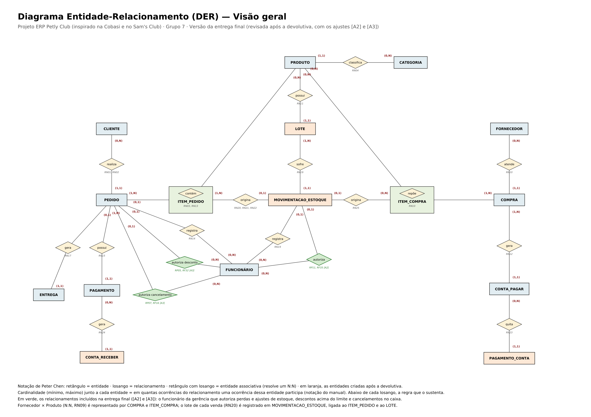

### Com atributos

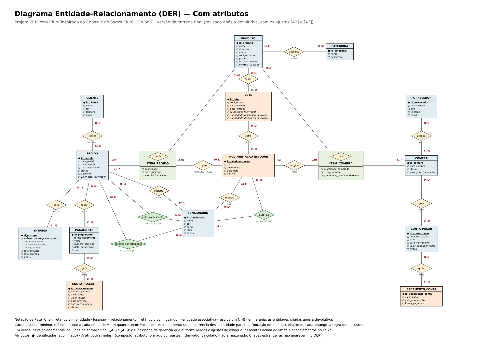

Legenda dos atributos: ● identificador (sublinhado) · ○ atributo simples · (composto) atributo formado por partes · (derivado) calculado, não armazenado. Fornecedor × Produto (N:N, RN09) é representado por meio de COMPRA e ITEM_COMPRA, sem ligação direta entre as duas entidades. O lote de onde saiu cada venda (RN20) é registrado em MOVIMENTACAO_ESTOQUE, ligada ao ITEM_PEDIDO e ao LOTE. Versão em PDF: [`der/DER.pdf`](der/DER.pdf).

## 17. Justificativas técnicas

**Separação entre Cliente e Pedido:** Um cliente pode realizar vários pedidos ao longo do tempo (RN01). Por isso, os dados do cliente ficam em uma entidade própria e não são repetidos em cada compra, evitando duplicidade e risco de inconsistência.

**Cardinalidade Cliente–Pedido: Cliente (0,N) — Pedido (1,1):** Um cliente cadastrado pode ainda não ter realizado nenhuma compra ou ter realizado várias (RN02), e cada pedido pertence a um único cliente, tanto na loja física quanto na loja virtual. Para isso, inspirada no modelo de clube de compras do Sam's Club, a empresa só vende para clientes cadastrados, inclusive no caixa da loja física (RP02), o que permite manter o histórico de compras de todos os clientes.

**Criação da entidade Item_Pedido:** Um pedido pode conter vários produtos e um produto pode aparecer em vários pedidos (RN03), caracterizando um relacionamento N:N. A entidade associativa Item_Pedido resolve essa relação e armazena as informações que pertencem ao relacionamento: a quantidade e o preço praticado. Sem ela, seria necessário repetir o pedido para cada produto ou criar campos como produto1, produto2 e produto3, e a quantidade não teria onde ser armazenada.

**Preço unitário no Item_Pedido:** O preço dos produtos muda ao longo do tempo. Guardar o preço praticado no item preserva o valor original de cada venda (RN13), enquanto o atributo preco de Produto representa apenas o preço atual.

**Atributos derivados:** Subtotal e valor total são calculados a partir da quantidade, do preço dos itens e do desconto. Por isso, foram identificados como atributos derivados: armazená-los criaria o risco de o total gravado divergir da soma real dos itens.

**Separação entre Produto e Categoria:** Cada produto pertence a uma categoria, e uma categoria agrupa vários produtos (RN04). A separação evita repetir as informações da categoria em cada produto e permite relatórios por categoria.

**Lote como entidade própria:** A empresa possui um único estoque, compartilhado pela loja física e pela loja virtual (RP01), e precisa controlar a validade dos produtos. Como um mesmo produto pode ter lotes com validades diferentes, cada lote é um registro da entidade Lote (RN11). A entidade se chamava Estoque na primeira versão; o nome mudou porque cada registro representa um lote, e não o estoque inteiro do produto.

**Movimentação de estoque e histórico:** Na primeira versão, a quantidade ficava gravada direto no lote e era sobrescrita a cada venda ou recebimento, o que apagava o histórico. Agora, toda alteração de quantidade é uma movimentação do lote, com tipo, quantidade, data, hora, responsável e motivo (RN19). Os saldos do lote passam a ser derivados das movimentações, que não podem ser alteradas nem excluídas: um erro é corrigido por um novo ajuste. Assim, qualquer diferença de estoque pode ser explicada pelo histórico.

**Lote de cada venda:** Um item vendido pode sair de mais de um lote, e um lote abastece várias vendas. A movimentação de venda liga o item do pedido ao lote de onde as unidades saíram, com a quantidade retirada de cada um (RN20). Por isso o lote não foi colocado como atributo do Item_Pedido: um único campo não comportaria uma venda que usa dois lotes.

**Reserva separada da baixa:** Na loja virtual, o produto precisa ficar garantido para o cliente entre o pedido e o envio, mas ainda não saiu fisicamente do estoque. Por isso o modelo separa a reserva (que reduz a quantidade disponível) da venda (que reduz o saldo físico) (RN21). Isso permite tratar o cancelamento corretamente: um produto apenas reservado só tem a reserva liberada, enquanto um produto já baixado volta por devolução ou é registrado como perda (RN22). A reserva não virou entidade própria porque é uma movimentação do mesmo histórico, e não um objeto com vida própria.

**Canal de venda no Pedido:** O modelo mantém uma única estrutura de clientes, produtos e pedidos para os dois canais, evitando os cadastros duplicados que a empresa tem hoje. O atributo canal_venda diferencia a origem de cada pedido (RN05) e permite comparar o desempenho da loja física e da loja virtual.

**Separação entre Pedido e Pagamento:** O pedido representa a venda; o pagamento representa a forma e a autorização financeira dessa venda. A separação permite registrar pagamentos pendentes, recusados ou estornados e mais de uma forma de pagamento no mesmo pedido (RN15).

**Pagamento autorizado separado do valor recebido (Conta_Receber):** Um pagamento aprovado no cartão não significa que o dinheiro já entrou na conta: no crédito em 3x, por exemplo, a empresa recebe uma parcela por mês, descontada a taxa da operadora. Por isso o pagamento registra a autorização, e cada valor a receber vira uma conta a receber, com data prevista, data do recebimento e valor líquido (RN24). Com isso, o fluxo de caixa separa o que foi autorizado, o que foi recebido e o que ainda está pendente.

**Entrega opcional: Pedido (0,1) — Entrega (1,1):** Somente pedidos da loja virtual com entrega em casa geram uma entrega; vendas no balcão e retiradas na loja não geram (RN17). Por isso, a entrega é opcional para o pedido e possui atributos próprios, como endereço, datas e status.

**Endereço registrado na Entrega:** O endereço só é necessário quando o pedido é entregue na casa do cliente. Por isso, ele foi registrado na entidade Entrega, como atributo composto, permitindo que cada entrega tenha seu próprio endereço sem obrigar clientes da loja física a informá-lo.

**Funcionário no Pedido: Funcionário (0,N) — Pedido (0,1):** O funcionário registra as vendas da loja física, e um mesmo funcionário registra vários pedidos (RN14). Pedidos da loja virtual são feitos pelo próprio cliente e não precisam de um funcionário responsável.

**Compra e Item_Compra:** Um produto pode ser comprado de vários fornecedores, e um fornecedor pode fornecer vários produtos (RN09). As entidades Compra e Item_Compra registram essa relação e o custo pago em cada compra (RN10), integrando a reposição ao controle de estoque (RN08).

**Conta_Pagar como entidade própria:** Uma compra de reposição pode ser paga em parcelas, cada uma com valor, vencimento e situação próprios (RN12). Por isso, as contas a pagar foram separadas da compra, assim como os pagamentos foram separados do pedido, integrando o processo de compras ao financeiro.

**Pagamentos de uma parcela (Pagamento_Conta):** Na primeira versão, a conta a pagar tinha um único campo de data de pagamento, o que só permitia registrar um pagamento por parcela. Agora cada pagamento é um registro de Pagamento_Conta, e a parcela só fica paga quando a soma dos pagamentos atinge o seu valor (RN23). Assim, um pagamento parcial não se perde, e o histórico financeiro fica completo.

**Compra recebida em partes:** O fornecedor pode entregar uma compra em mais de uma vez. Como cada entrega gera movimentações de entrada ligadas ao item da compra, a quantidade recebida é derivada dessas movimentações e pode ser comparada com a quantidade comprada (RN25), sem precisar de uma entidade separada para cada recebimento.

**Cliente e Funcionário separados:** Foi considerada a generalização Pessoa, mas as duas entidades têm finalidades e atributos diferentes: o cliente realiza pedidos e precisa de e-mail para a loja virtual; o funcionário registra vendas e possui cargo, login e senha. Os dados em comum se limitam a nome e CPF, e um funcionário que compra na loja é cadastrado também como cliente. A separação mantém o modelo mais simples, e a generalização fica como possível evolução.

**Atributos de controle:** Os atributos estoque_minimo e controla_validade, em Produto, sustentam a reposição no nível mínimo (RP03) e o controle de validade por lote (RN11). O desconto, em Pedido, registra o valor concedido, que acima do limite exige autorização da gerência (RP05). Login e senha, em Funcionário, permitem o acesso ao sistema de acordo com o cargo (RP08). O código de barras, em Produto, permite a leitura e a busca rápida dos produtos no caixa (RNF05).

**Identificação única das entidades:** Cada entidade possui um identificador próprio, como id_cliente, id_produto e id_pedido, que não muda ao longo do tempo e diferencia cada registro, sem depender de dados que podem se repetir, como nome ou data.

**Limitação do escopo:** O modelo contempla somente a comercialização de produtos para animais. Não foram incluídos banho e tosa, serviços veterinários ou venda de animais (RP10), pois pertencem a outro domínio de negócio e exigiriam entidades como agendamento, profissional e animal atendido.

**Loja física e virtual:** O modelo foi pensado para atender vendas realizadas nos dois canais, mantendo a estrutura de produtos, clientes e pedidos independente do canal utilizado e com um único estoque (RP01).

Essas decisões buscam evitar duplicidade de informações, representar corretamente os relacionamentos entre os dados e integrar vendas, estoque, compras e financeiro, mantendo o modelo preparado para as próximas etapas, como modelo lógico, normalização e implementação do banco de dados.

### 17.1 Validação do modelo com cenários de teste

Seguindo a recomendação da devolutiva, o modelo foi testado com situações reais de operação: vendas simultâneas, produtos vencidos, lotes com validades diferentes, compras recebidas em partes, pagamentos parciais, crédito parcelado e cancelamentos. Em cada cenário, a tabela mostra os registros que o modelo guarda. Os valores são exemplos.

#### Cenário 1 — Duas vendas simultâneas da última unidade

**Situação:** a Ração para Gato 1 kg tem uma única unidade, no lote L-101. Às 10h00 um cliente passa essa unidade no caixa e, no mesmo segundo, outro cliente faz um pedido dela na loja virtual.

| Ordem | Registro | Resultado |
|---|---|---|
| 1 | MOVIMENTACAO_ESTOQUE: venda, 1 un., lote L-101, item do pedido 5021 (caixa) | Gravada primeiro; quantidade disponível do L-101 passa para 0 |
| 2 | Tentativa de reserva de 1 un. para o pedido 5022 (loja virtual) | Recusada: a quantidade disponível é 0 (RN07); o pedido não é concluído e o produto sai do catálogo (RF17) |

**O que o modelo garante:** como a disponibilidade é calculada pelas movimentações do lote, e cada venda ou reserva é uma operação única (RNF10), as duas vendas não conseguem usar a mesma unidade. O saldo nunca fica negativo.

#### Cenário 2 — Venda que usa dois lotes com validades diferentes

**Situação:** a Ração para Cão 15 kg tem 2 unidades no lote L-201 (vence em 10/11/2026) e 10 no lote L-202 (vence em 15/03/2027). Um cliente compra 3 unidades no caixa (pedido 5030).

| Registro | Entidade | Dados |
|---|---|---|
| Item do pedido | ITEM_PEDIDO | pedido 5030, Ração para Cão 15 kg, quantidade 3, preço R$ 189,90 |
| Saída do primeiro lote | MOVIMENTACAO_ESTOQUE | venda, 2 un., lote L-201, item 5030 |
| Saída do segundo lote | MOVIMENTACAO_ESTOQUE | venda, 1 un., lote L-202, item 5030 |

**O que o modelo garante:** a venda sai primeiro do lote que vence antes (RN20, RF11), e a consulta às movimentações do item 5030 mostra exatamente de qual lote saiu cada unidade. Se houver um recall do lote L-201, é possível saber quais clientes receberam produtos dele.

#### Cenário 3 — Produto vencido no estoque

**Situação:** em 21/10/2026, o estoquista encontra 4 unidades do Petisco Dental no lote L-305, que venceu em 20/10/2026.

| Registro | Entidade | Dados |
|---|---|---|
| Bloqueio | LOTE L-305 | data_validade 20/10/2026 já passou: o sistema impede a venda e a reserva (RF12) |
| Retirada da venda | MOVIMENTACAO_ESTOQUE | perda, 4 un., lote L-305, motivo "validade expirada", estoquista responsável, autorizada pela gerência (RP11) |

**O que o modelo garante:** o saldo do lote vai para 0 (RP09), mas o histórico mostra quando o lote entrou, quanto foi vendido e quanto foi perdido. Isso permite medir as perdas por vencimento e ajustar as próximas compras.

#### Cenário 4 — Compra recebida em duas entregas

**Situação:** a compra 125, feita ao Fornecedor X, tem 50 unidades da Ração A e 30 da Ração B. Na primeira entrega (26/10) chegam 50 da Ração A e só 10 da Ração B; as outras 20 chegam em 30/10, de outro lote.

| Data | Registro | Situação depois do registro |
|---|---|---|
| 26/10 | Entrada de 50 un. da Ração A (lote A-77) e 10 un. da Ração B (lote B-12), ligadas aos itens da compra 125 | Ração A: recebida 50 de 50; Ração B: recebida 10 de 30; compra "recebida parcialmente" |
| 30/10 | Entrada de 20 un. da Ração B (lote B-15), ligada ao item da Ração B | Ração B: recebida 30 de 30; compra "recebida" |

**O que o modelo garante:** a quantidade recebida é derivada das entradas (RN25), então a compra mostra o que ainda falta chegar. Como a segunda entrega veio de outro lote, cada lote tem a sua validade registrada.

#### Cenário 5 — Pagamento parcial de uma parcela ao fornecedor

**Situação:** a compra 125 custou R$ 3.000,00, divididos em 3 parcelas de R$ 1.000,00. A primeira vence em 10/11 e é paga em duas vezes.

| Data | Registro | Situação da parcela 1 |
|---|---|---|
| 10/11 | PAGAMENTO_CONTA: R$ 600,00 via Pix | valor pago R$ 600,00; "paga parcialmente"; saldo devedor R$ 400,00 |
| 17/11 | PAGAMENTO_CONTA: R$ 400,00 via boleto | valor pago R$ 1.000,00; "paga" |

**O que o modelo garante:** os dois pagamentos ficam guardados, com data e forma, e a parcela só é considerada paga quando a soma chega ao seu valor (RN23).

#### Cenário 6 — Venda no crédito em 3x: autorizado, recebido e pendente

**Situação:** em 26/10, um cliente faz o pedido 5040 de R$ 300,00 na loja virtual e paga no cartão de crédito em 3x sem juros. A taxa da operadora é de 3% (exemplo).

| Registro | Entidade | Dados |
|---|---|---|
| Autorização | PAGAMENTO | R$ 300,00, crédito, 3 parcelas, autorizado em 26/10 |
| Parcela 1 | CONTA_RECEBER | bruto R$ 100,00, líquido R$ 97,00, prevista para 25/11 |
| Parcela 2 | CONTA_RECEBER | bruto R$ 100,00, líquido R$ 97,00, prevista para 25/12 |
| Parcela 3 | CONTA_RECEBER | bruto R$ 100,00, líquido R$ 97,00, prevista para 24/01 |

**Fluxo de caixa em 30/11:** autorizado R$ 300,00; recebido R$ 97,00 (parcela 1, conciliada em 25/11); pendente R$ 194,00 (parcelas 2 e 3).

**O que o modelo garante:** a venda não aparece como dinheiro em caixa antes de entrar na conta (RN24), e o financeiro sabe quanto ainda vai receber e quando.

#### Cenário 7 — Cancelamento de um pedido apenas reservado

**Situação:** em 26/10, o cliente faz o pedido 5050 na loja virtual com 2 unidades da Ração para Cão 15 kg, e o pagamento por Pix não é confirmado.

| Ordem | Registro | Efeito no lote L-202 |
|---|---|---|
| 1 | MOVIMENTACAO_ESTOQUE: reserva, 2 un., item 5050 | Saldo físico 9; reservado 2; disponível 7 |
| 2 | Pagamento não confirmado: status "recusado" | Nenhum valor a receber é gerado |
| 3 | MOVIMENTACAO_ESTOQUE: liberação de reserva, 2 un., item 5050 | Saldo físico 9; reservado 0; disponível 9 |
| 4 | PEDIDO 5050: status "cancelado" | — |

**O que o modelo garante:** como os produtos nunca saíram do estoque, não há devolução: só a reserva é liberada (RN22). O saldo físico não muda em nenhum momento.

#### Cenário 8 — Cancelamento de uma venda já baixada

**Situação:** no caixa, o pedido 5060 (1 Shampoo Neutro do lote L-410 e 1 Ração A do lote A-77) é pago com cartão de débito e a baixa é feita. Antes de sair da loja, o cliente desiste da compra; a embalagem da ração rasgou no balcão.

| Ordem | Registro | Dados |
|---|---|---|
| 1 | Autorização da gerência | Exigida para cancelar na loja física (RP07) |
| 2 | MOVIMENTACAO_ESTOQUE: devolução | 1 un. do shampoo volta ao lote L-410, motivo "cancelamento no caixa" |
| 3 | MOVIMENTACAO_ESTOQUE: perda | 1 un. da Ração A, lote A-77, motivo "embalagem danificada" |
| 4 | PAGAMENTO: status "estornado" | A conta a receber ligada a ele passa para "cancelada" |
| 5 | PEDIDO 5060: status "cancelado" | — |

**O que o modelo garante:** os produtos já baixados voltam ao lote de origem por devolução, ou são registrados como perda quando não podem voltar à venda (RN22). O histórico mostra a venda, a devolução e a perda, e o financeiro não conta um valor que foi estornado.

## 18. Conclusão da primeira entrega

Esta primeira entrega transformou a situação da Petly Club, um pet shop de pequeno porte inspirado na Cobasi e no Sam's Club, em um modelo conceitual de dados. O ponto de partida foi o problema real da empresa: duas lojas, uma física e uma virtual, que compartilham o mesmo estoque, mas registram vendas, clientes e produtos em sistemas e planilhas que não se comunicam, gerando cadastros duplicados, estoque desatualizado e retrabalho no financeiro.

Seguindo o caminho proposto no manual, a equipe partiu da caracterização da empresa e dos processos de negócio, identificou os problemas e necessidades, levantou os requisitos, as regras de negócio e as políticas organizacionais e só então definiu as entidades, os atributos, os relacionamentos e as cardinalidades. Cada decisão de modelagem foi apoiada em uma regra de negócio numerada, o que permite responder, para cada elemento do DER, de onde veio aquela decisão.

Depois da devolutiva, o modelo foi testado com situações operacionais mais complexas e passou a ter 16 entidades. O estoque deixou de guardar apenas o saldo e passou a registrar cada movimentação por lote, o que permite saber de qual lote saiu cada venda, separar o que está reservado do que já foi baixado e tratar corretamente cancelamentos, devoluções, perdas e compras recebidas em partes. No financeiro, o modelo passou a separar o pagamento autorizado do valor efetivamente recebido e a registrar pagamentos parciais das parcelas devidas aos fornecedores. Os requisitos não funcionais ganharam critérios mensuráveis, e oito cenários de teste mostram o comportamento do modelo nessas situações.

Os relacionamentos N:N entre Pedido e Produto e entre Compra e Produto continuam resolvidos pelas entidades associativas Item_Pedido e Item_Compra, que guardam a quantidade, o preço praticado e o custo de cada compra. Esse modelo é a base para as próximas etapas do projeto: o modelo lógico, a normalização, o modelo físico e a implementação do banco de dados, com as regras transacionais necessárias para vendas simultâneas e cancelamentos, que darão suporte às análises de BI e IA previstas para o ERP.

# Parte 2 — Entrega final: do modelo ao banco implementado

A partir daqui está a entrega final. O modelo conceitual das seções 1 a 18 (já revisado após a devolutiva) foi convertido em modelo lógico, normalizado até a 3FN, implementado em PostgreSQL 16, povoado com uma massa de dados de teste e consultado para produzir informação gerencial. Cada seção resume a decisão tomada e aponta o arquivo onde está o detalhe.

**Teste de consistência:** em 29/10/2026 todos os scripts foram executados, na ordem da seção 22, em um banco vazio. As 16 tabelas, as 7 visões e os 5 gatilhos foram criados sem erro, a massa de dados foi carregada, os 23 comandos que o banco deve recusar (T01 a T23) terminaram em `ERROR`, os testes de UPDATE e DELETE foram aceitos e as 10 consultas de auditoria retornaram 0 linhas. A saída completa está em [`evidencias/saida_execucao_completa.txt`](evidencias/saida_execucao_completa.txt).

## 19. Revisão do modelo conceitual na entrega final

As mudanças de decisão de modelagem feitas depois da primeira entrega estão na tabela [Revisão após a devolutiva](#revisão-após-a-devolutiva), no início deste README. Ao converter o DER para o modelo lógico, a equipe fez mais três ajustes, aprovados e identificados como [A1], [A2] e [A3] em todos os artefatos:

| Ajuste | O que mudou | Por quê |
|---|---|---|
| [A1] | `movimentacao_estoque` tem uma única coluna `id_produto`, usada pelas FKs compostas para `lote`, `item_pedido` e `item_compra` | Garante que a movimentação saia de um lote do mesmo produto do item vendido ou comprado (o banco recusa o contrário, teste T06) |
| [A2] | Coluna `id_autorizador` em `movimentacao_estoque` | RP11 e RF35: perda e ajuste de estoque só com autorização registrada (teste T13) |
| [A3] | Colunas `id_autorizador_desconto` e `id_autorizador_cancelamento` em `pedido` | Desconto e cancelamento no caixa precisam de quem autorizou (teste T12) |

As regras de negócio que esses ajustes protegem já existiam na primeira entrega. [A1] é uma decisão do modelo lógico (chaves estrangeiras não aparecem no DER). [A2] e [A3] são relacionamentos novos e foram incluídos no DER da [seção 16](#16-der), destacados em verde:

| Relacionamento novo | Cardinalidade | Regra |
|---|---|---|
| FUNCIONÁRIO — autoriza — MOVIMENTACAO_ESTOQUE | Funcionário (0,N) · Movimentação (0,1) | RP11, RF35 [A2] |
| FUNCIONÁRIO — autoriza desconto — PEDIDO | Funcionário (0,N) · Pedido (0,1) | RP05, RF32 [A3] |
| FUNCIONÁRIO — autoriza cancelamento — PEDIDO | Funcionário (0,N) · Pedido (0,1) | RP07, RF16 [A3] |

O DER é gerado pelo script [`der/gerar_der.py`](der/gerar_der.py), o que permite atualizar o diagrama junto com o modelo.

## 20. Modelo lógico relacional

16 tabelas, uma para cada entidade do DER. Os dois relacionamentos N:N (Pedido–Produto e Compra–Produto) viraram as tabelas associativas `item_pedido` e `item_compra`, com chave primária composta. Notação: **PK** em negrito, *FK* em itálico e ***PK + FK*** nas chaves compostas.

| Tabela | Colunas |
|---|---|
| categoria | **id_categoria**, nome, descricao |
| cliente | **id_cliente**, nome, cpf, telefone, email |
| funcionario | **id_funcionario**, nome, cpf, cargo, login, senha |
| fornecedor | **id_fornecedor**, razao_social, cnpj, telefone, email |
| produto | **id_produto**, nome, descricao, marca, codigo_barras, preco, estoque_minimo, controla_validade, *id_categoria* |
| lote | **id_lote**, *id_produto*, codigo_lote, data_validade, data_entrada |
| pedido | **id_pedido**, *id_cliente*, *id_funcionario*, data_pedido, canal_venda, tipo_recebimento, status, desconto, *id_autorizador_desconto*, *id_autorizador_cancelamento* |
| item_pedido | ***id_pedido***, ***id_produto***, quantidade, preco_unitario |
| pagamento | **id_pagamento**, *id_pedido*, forma_pagamento, valor, numero_parcelas, data_autorizacao, status |
| conta_receber | **id_conta_receber**, *id_pagamento*, numero_parcela, valor_bruto, valor_liquido, data_prevista, data_recebimento, status |
| entrega | **id_entrega**, *id_pedido*, logradouro, numero, complemento, bairro, cidade, uf, cep, data_prevista, data_entrega, status |
| compra | **id_compra**, *id_fornecedor*, data_compra, status |
| item_compra | ***id_compra***, ***id_produto***, quantidade_comprada, custo_unitario |
| conta_pagar | **id_conta_pagar**, *id_compra*, numero_parcela, valor, data_vencimento, status |
| pagamento_conta | **id_pagamento_conta**, *id_conta_pagar*, valor_pago, data_pagamento, forma_pagamento |
| movimentacao_estoque | **id_movimentacao**, *id_lote*, *id_produto*, tipo, quantidade, data_hora, motivo, *id_funcionario*, *id_autorizador*, *id_pedido*, *id_compra* |

**Principais decisões:**

- **PK:** chave substituta `INTEGER GENERATED ALWAYS AS IDENTITY` em todas as tabelas independentes. CPF, CNPJ e código de barras são únicos, mas podem ser corrigidos no cadastro; por isso ficam como `UNIQUE`, e não como PK. O banco não aceita que a aplicação escolha o id (teste T02).
- **PK composta:** em `item_pedido` (id_pedido, id_produto) e `item_compra` (id_compra, id_produto), porque o mesmo produto só aparece uma vez em cada pedido ou compra (testes T18 e T19).
- **FK:** 21 chaves estrangeiras representam os relacionamentos 1:N do DER, todas com `ON DELETE RESTRICT`: excluir um cliente com pedidos é recusado (teste T07), para não apagar histórico de vendas.
- **Atributos derivados** (saldos do lote, totais do pedido e da compra, valor pago, quantidade recebida) não são colunas: são calculados pelas visões `v_lote_saldo`, `v_pedido_total`, `v_compra_total`, `v_conta_pagar_saldo`, `v_item_compra_recebido` e `v_produto_estoque`.

Documento completo, com a justificativa de cada PK, FK e restrição: [`docs/modelo-logico/Modelo_Logico_Petly_Club_Grupo7.pdf`](docs/modelo-logico/Modelo_Logico_Petly_Club_Grupo7.pdf) (versão editável em [`.docx`](docs/modelo-logico/Modelo_Logico_Petly_Club_Grupo7.docx))

## 21. Normalização (1FN, 2FN e 3FN)

Cada tabela foi analisada no formato do manual: estrutura analisada → dependência funcional → problema → correção. Os problemas reais encontrados no modelo conceitual foram:

| Tabela | Forma normal | Problema | Correção |
|---|---|---|---|
| ENTREGA | 1FN | `endereco_entrega` era um atributo composto em um único campo | Decomposto em logradouro, numero, complemento, bairro, cidade, uf e cep |
| PEDIDO, COMPRA | 3FN | `valor_total` dependia dos itens, e não da chave | Coluna removida; total calculado pelas visões `v_pedido_total` e `v_compra_total` |
| ITEM_PEDIDO | 3FN | `subtotal` = quantidade × preco_unitario | Coluna removida; calculado na consulta |
| LOTE, ITEM_COMPRA, CONTA_PAGAR | 3FN | Saldos, quantidade recebida e valor pago dependiam das movimentações e pagamentos | Colunas removidas; calculadas a partir de MOVIMENTACAO_ESTOQUE e PAGAMENTO_CONTA |
| MOVIMENTACAO_ESTOQUE | 3FN | `id_produto` repetido nas FKs compostas e dependência transitiva id_lote → id_produto | Uma única coluna `id_produto`, mantida como redundância intencional e controlada pela FK composta (id_lote, id_produto) → LOTE [A1] |

**2FN nas tabelas associativas:** em `item_pedido`, `quantidade` e `preco_unitario` dependem da chave toda (id_pedido, id_produto): o preço praticado é o daquele produto naquele pedido, e não o preço atual do produto (RN13). O nome e a marca do produto, que dependeriam só de id_produto, ficam em `produto`.

Documento completo: [`docs/normalizacao/Normalizacao_Petly_Club.pdf`](docs/normalizacao/Normalizacao_Petly_Club.pdf)

## 22. Dicionário de dados e implementação SQL

O dicionário de dados descreve as 16 tabelas implementadas, campo a campo (tipo, tamanho, PK, FK, nulo, UNIQUE, DEFAULT e a regra que cada restrição protege), e foi conferido com o script: todas as 104 colunas do banco estão documentadas. O dicionário conceitual da seção 15 continua neste README como registro da primeira entrega.

- Dicionário de dados: [`docs/dicionario-dados/Dicionario_de_Dados_Petly_Club_Grupo7.pdf`](docs/dicionario-dados/Dicionario_de_Dados_Petly_Club_Grupo7.pdf)
- Script DDL: [`sql/ddl/petly_club_ddl_limpo.sql`](sql/ddl/petly_club_ddl_limpo.sql) — `CREATE DATABASE`, 16 `CREATE TABLE`, 16 PK, 21 FK, 11 UNIQUE, CHECK, DEFAULT e NOT NULL, 7 visões e 5 gatilhos

**Restrições que o próprio banco garante (exemplos):**

| Regra de negócio | Restrição | Teste |
|---|---|---|
| RN18: o mesmo CPF não pode ser cadastrado duas vezes | `uk_cliente_cpf` (UNIQUE) | T03 |
| Preço de venda sempre maior que zero | `ck_produto_preco` (CHECK) | T09 |
| Loja física não faz entrega | `ck_pedido_canal_recebimento` (CHECK) | T10 |
| Crédito em até 3x; débito não parcela | `ck_pag_parcelas`, `ck_pag_parcelas_credito` (CHECK) | T15, T16 |
| RN19: movimentação de estoque não é alterada nem excluída | gatilho `trg01_mov_imutavel` | T20 |
| RN07: não vender sem saldo no lote | gatilho `trg02_mov_saldo` | T21 |
| RF12: não dar entrada em lote vencido | gatilho `trg03_mov_validade` | T22 |
| RN23: não pagar mais que o valor da parcela | gatilho `trg08_pagconta_valida` | T23 |

As demais regras de transação (TRG-04 a TRG-07 e TRG-09 a TRG-18) ficam a cargo da aplicação e estão descritas na seção 6 do modelo lógico.

### Como executar o projeto

Pré-requisito: PostgreSQL 16 com o `psql` (o DDL usa `\c` para se conectar ao banco criado). A partir da raiz do repositório:

```bash
psql -U postgres -f sql/ddl/petly_club_ddl_limpo.sql                                   # 1. cria o banco e a estrutura
psql -U postgres -d petly_club -f "sql/dados/Massa_de_Dados_Completa_-_ERP_Petly_Club.sql"   # 2. massa de dados
psql -U postgres -d petly_club -a -f sql/testes/testes_integridade.sql                 # 3. testes de integridade, UPDATE e DELETE
psql -U postgres -d petly_club -f sql/consultas/consultas_gerenciais.sql               # 4. consultas gerenciais
psql -U postgres -d petly_club -f sql/auditoria/consultas_auditoria.sql                # 5. consultas de auditoria
```

| Comando exigido no manual | Onde está |
|---|---|
| CREATE DATABASE, CREATE TABLE, PK, FK, NOT NULL, UNIQUE, CHECK, DEFAULT | `sql/ddl/petly_club_ddl_limpo.sql` |
| INSERT | `sql/dados/Massa_de_Dados_Completa_-_ERP_Petly_Club.sql` |
| UPDATE e DELETE | `sql/testes/testes_integridade.sql` (U01 a U03 e D01, dentro de `BEGIN ... ROLLBACK`) |
| SELECT e JOIN | `sql/consultas/consultas_gerenciais.sql` e `sql/auditoria/consultas_auditoria.sql` |

## 23. Massa de dados

A massa de dados foi gerada com auxílio de IA e validada pela equipe executando o script no banco: todas as PKs, FKs, CHECKs e gatilhos foram respeitados na carga. Ela não busca volume, e sim cobrir os oito cenários da seção 17.1 com dados coerentes entre si (data de referência 27/10/2026): 6 clientes, 4 funcionários, 3 fornecedores, 4 categorias, 6 produtos, 11 lotes (incluindo lote vencido e lote perto de vencer), 6 pedidos nos dois canais (pagos, enviado, retirado e dois cancelamentos de tipos diferentes), 5 compras (uma recebida em partes), 28 movimentações de estoque, crédito em 3x e pagamento parcial de fornecedor.

- Script: [`sql/dados/Massa_de_Dados_Completa_-_ERP_Petly_Club.sql`](sql/dados/Massa_de_Dados_Completa_-_ERP_Petly_Club.sql)
- Prompts utilizados: [`sql/dados/Prompts_Utilizados_ERP_Petly_Club.pdf`](sql/dados/Prompts_Utilizados_ERP_Petly_Club.pdf)

**Testes de integridade:** 23 comandos que o banco deve recusar (T01 a T23, um para cada restrição relevante) e 4 operações que deve aceitar (U01 a U03 e D01). Script em [`sql/testes/testes_integridade.sql`](sql/testes/testes_integridade.sql) e evidências em [`evidencias/Testes_de_Integridade_Petly_Club.pdf`](evidencias/Testes_de_Integridade_Petly_Club.pdf).

## 24. Consultas gerenciais

Cada consulta parte de uma pergunta da gerência e termina em uma decisão.

| # | Pergunta do negócio | Decisão que apoia |
|---|---|---|
| G01 | Quais são os 5 produtos mais vendidos em cada canal? | Priorizar reposição e destaque dos mais vendidos de cada canal |
| G02 | Quanto vendemos por mês, em cada canal, e qual o ticket médio? | Planejar promoções e compras para os períodos fracos |
| G03 | Quais produtos estão no estoque mínimo ou abaixo? | Gerar a solicitação de compra, começando pela maior falta |
| G04 | Quais lotes com saldo vencem nos próximos 30 dias ou já venceram? | Dar saída aos que vencem primeiro e registrar a perda dos vencidos |
| G05 | Quanto vamos receber em cada mês, por forma de pagamento? | Projetar o fluxo de caixa e avaliar o peso das taxas |

- SQL executável: [`sql/consultas/consultas_gerenciais.sql`](sql/consultas/consultas_gerenciais.sql)
- Explicação de cada consulta: [`sql/consultas/consultas_gerenciais.md`](sql/consultas/consultas_gerenciais.md)

## 25. Consultas de auditoria

As consultas de auditoria procuram situações que o banco não impede sozinho e que precisam de conferência. Na massa de dados do grupo, todas retornam 0 linhas.

| # | O que verifica |
|---|---|
| AU01 | Pedidos concluídos sem pagamento suficiente |
| AU02 | Pedidos sem itens |
| AU03 | Itens vendidos sem baixa correta no estoque |
| AU04 | Reservas presas em pedidos encerrados |
| AU05 | Pagamentos e contas a receber que não batem |
| AU06 | Compras com recebimento ou financeiro inconsistente |
| AU07 | Lotes vencidos ainda com saldo |
| AU08 | Perdas e ajustes autorizados por quem não é gerente |
| AU09 | Descontos sem autorização registrada |
| AU10 | Cadastros de clientes possivelmente duplicados |

- SQL: [`sql/auditoria/consultas_auditoria.sql`](sql/auditoria/consultas_auditoria.sql)
- Documento com a finalidade e o resultado de cada consulta: [`docs/auditoria/Consultas_de_Auditoria_Petly_Club.pdf`](docs/auditoria/Consultas_de_Auditoria_Petly_Club.pdf)

## 26. Análise de dados, BI e IA

Nada desta seção está implementado; ela mostra o que o modelo já permite extrair, no formato problema → dados → análise → benefício.

- **Indicadores:** faturamento por canal, ticket médio, produtos mais vendidos, vendas por categoria, margem bruta, taxa de cancelamento, perdas por motivo, giro de estoque, autorizado × recebido, valores a receber e contas a pagar, prazo médio de entrega e frequência de recompra.
- **BI:** três painéis (Gerência, Estoque e Financeiro), cada gráfico ligado ao indicador e à decisão que apoia.
- **IA 1 — Previsão de demanda de ração e sugestão de compra:** usa o histórico de `item_pedido`, o saldo disponível dos lotes e o prazo do fornecedor para estimar quando o produto acaba e quando comprar.
- **IA 2 — Alerta de lotes com risco de vencer sem vender:** cruza a validade do lote com o ritmo de vendas do produto para agir antes da perda.
- **Limite reconhecido:** a massa de dados cobre poucos dias; tendências e previsões só ficam confiáveis depois de alguns meses de vendas reais registradas.

Documento completo: [`docs/bi-ia/Analise_de_Dados_BI_e_IA_Petly_Club.pdf`](docs/bi-ia/Analise_de_Dados_BI_e_IA_Petly_Club.pdf)

## 27. Histórico e evolução do projeto

| Período | Etapa |
|---|---|
| Agosto a setembro de 2026 | Primeira entrega: empresa, processos, requisitos, regras, DER e dicionário conceitual |
| 24/09/2026 | Auditoria do modelo em sala |
| 01/10/2026 | Normalização em sala (aula 8) |
| 15/10/2026 | Primeiro DDL e testes em sala (aula 9), em [`diarios-de-bordo/aula9_sql/`](diarios-de-bordo/aula9_sql/) |
| 26/10/2026 | Revisão da primeira entrega conforme a devolutiva |
| 27 e 28/10/2026 | Modelo lógico, normalização, DDL, massa de dados, testes, consultas, auditoria, BI e dicionário de dados |

O histórico de commits mostra a contribuição de cada integrante na sua parte. A divisão de responsabilidades e a participação em cada aula estão nos [diários de bordo](diarios-de-bordo/Diarios_de_Bordo_Grupo7.pdf).

## 28. Conclusão

A entrega final transformou o modelo conceitual da Petly Club em um banco de dados que funciona. O modelo lógico mantém as 16 entidades do DER, os dois relacionamentos N:N foram resolvidos com tabelas associativas de chave composta, e a normalização retirou do modelo os atributos derivados que poderiam ficar desatualizados, como saldos de estoque e totais de pedido. As regras mais críticas do negócio, como não vender sem saldo, não alterar o histórico de estoque e não pagar mais que o valor de uma parcela, são garantidas pelo próprio banco e foram provadas com testes que o banco recusa. Por fim, as consultas gerenciais e de auditoria mostram que os dados registrados já geram informação para a gerência, e a análise de BI e IA indica os próximos passos para transformar esses dados em decisão.

---

## Uso de Inteligência Artificial

**Ferramentas:** Claude (Anthropic), ChatGPT (OpenAI) e Gemini (Google)

**Finalidades:**

- Revisão das partes do projeto, verificando se estavam coerentes entre si e de acordo com o modelo pedido pelo professor;
- Apoio na formação e na formatação deste README;
- Verificação do checklist do manual, para conferir se todos os pontos do trabalho foram atendidos;
- Apoio para juntar as partes feitas pelos integrantes em um único documento;
- Geração da massa de dados em escala, com os prompts documentados em [`sql/dados/Prompts_Utilizados_ERP_Petly_Club.pdf`](sql/dados/Prompts_Utilizados_ERP_Petly_Club.pdf);
- Apoio na elaboração das consultas de auditoria (registrado no próprio script).

**Como a equipe validou os resultados:** comparamos os resultados de diferentes ferramentas de IA antes de fazer as mudanças no projeto. Todo SQL gerado com auxílio de IA foi executado no PostgreSQL 16 em banco vazio: a massa de dados respeitou todas as PKs, FKs, CHECKs e gatilhos, os testes de integridade tiveram o resultado esperado e as consultas foram conferidas com os dados (seção 22).

---

### Documentos do repositório

**Primeira entrega**

- **Documentação completa em PDF (primeira entrega revisada):** [`docs/Documentacao_Completa_Grupo7.pdf`](docs/Documentacao_Completa_Grupo7.pdf)
- **DER (versão da entrega final):** [`der/DER.pdf`](der/DER.pdf) · script que gera o diagrama: [`der/gerar_der.py`](der/gerar_der.py)
- **Fluxogramas:** pasta [`fluxogramas/`](fluxogramas/)

**Entrega final**

| Artefato | Arquivo |
|---|---|
| Modelo lógico | [`docs/modelo-logico/Modelo_Logico_Petly_Club_Grupo7.pdf`](docs/modelo-logico/Modelo_Logico_Petly_Club_Grupo7.pdf) · [`.docx`](docs/modelo-logico/Modelo_Logico_Petly_Club_Grupo7.docx) |
| Normalização | [`docs/normalizacao/Normalizacao_Petly_Club.pdf`](docs/normalizacao/Normalizacao_Petly_Club.pdf) |
| Dicionário de dados | [`docs/dicionario-dados/Dicionario_de_Dados_Petly_Club_Grupo7.pdf`](docs/dicionario-dados/Dicionario_de_Dados_Petly_Club_Grupo7.pdf) |
| Script DDL | [`sql/ddl/petly_club_ddl_limpo.sql`](sql/ddl/petly_club_ddl_limpo.sql) |
| Massa de dados e prompts | [`sql/dados/`](sql/dados/) |
| Testes de integridade | [`sql/testes/testes_integridade.sql`](sql/testes/testes_integridade.sql) · [`evidencias/Testes_de_Integridade_Petly_Club.pdf`](evidencias/Testes_de_Integridade_Petly_Club.pdf) |
| Consultas gerenciais | [`sql/consultas/consultas_gerenciais.sql`](sql/consultas/consultas_gerenciais.sql) · [`consultas_gerenciais.md`](sql/consultas/consultas_gerenciais.md) |
| Consultas de auditoria | [`sql/auditoria/consultas_auditoria.sql`](sql/auditoria/consultas_auditoria.sql) · [`docs/auditoria/Consultas_de_Auditoria_Petly_Club.pdf`](docs/auditoria/Consultas_de_Auditoria_Petly_Club.pdf) |
| Análise de dados, BI e IA | [`docs/bi-ia/Analise_de_Dados_BI_e_IA_Petly_Club.pdf`](docs/bi-ia/Analise_de_Dados_BI_e_IA_Petly_Club.pdf) |
| Saída da execução completa | [`evidencias/saida_execucao_completa.txt`](evidencias/saida_execucao_completa.txt) |

**Diários de bordo**

- [`diarios-de-bordo/Diarios_de_Bordo_Grupo7.pdf`](diarios-de-bordo/Diarios_de_Bordo_Grupo7.pdf)
- Preenchidos depois da aula (auditoria de 24/09, normalização de 01/10 e DDL de 15/10, preenchidos em 26/10/2026):
  - [`diarios-de-bordo/Diario_Auditoria_24-09_Grupo7.pdf`](diarios-de-bordo/Diario_Auditoria_24-09_Grupo7.pdf)
  - [`diarios-de-bordo/Diario_Aula8_Normalizacao_01-10_Grupo7.pdf`](diarios-de-bordo/Diario_Aula8_Normalizacao_01-10_Grupo7.pdf)
  - [`diarios-de-bordo/Diario_Aula9_DDL_15-10_Grupo7.pdf`](diarios-de-bordo/Diario_Aula9_DDL_15-10_Grupo7.pdf), com o script e os testes em [`diarios-de-bordo/aula9_sql/`](diarios-de-bordo/aula9_sql/)
